# Elgato Stream Deck for Linux (LinDeck)

[English](README.md) · **Deutsch**

Linux-Ersatz für die Elgato-Stream-Deck-Software. LinDeck steuert alle
Stream-Deck-Modelle per USB und liest die Profile der Elgato-App **direkt und
unverändert** ein – Tasten, Icons, Titel, Ordner, Seiten, Multi-Actions, Dials
und Touchstreifen. Ein Neu-Einrichten unter Linux ist nicht nötig – und im
LinDeck-Fenster lassen sich Profile direkt unter Linux bearbeiten oder neu anlegen.

**Zwei Programme wie bei Elgato:**

| Programm | Elgato-Gegenstück | Aufgabe |
|---|---|---|
| **LinDeck** (`lindeck`) | Stream Deck | Tasten, Profile, Plugins |
| **Linewave** (`linewave`) | Wave Link | Audio-Mixer (Monitor-/Stream-Mix) und Wave-Mikrofon |

| LinDeck – Tasten und Profile einrichten | Linewave – Mixer für Kopfhörer und Stream |
|---|---|
| 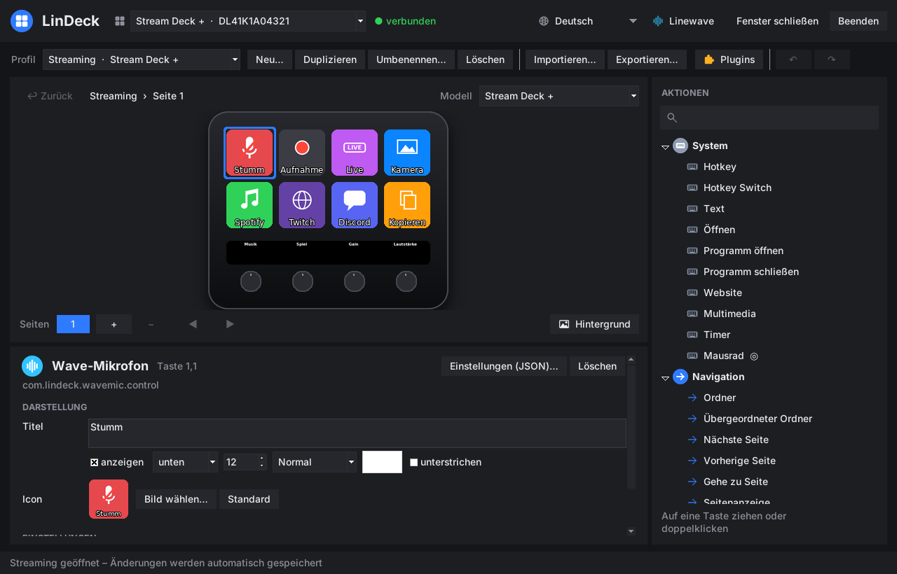 | 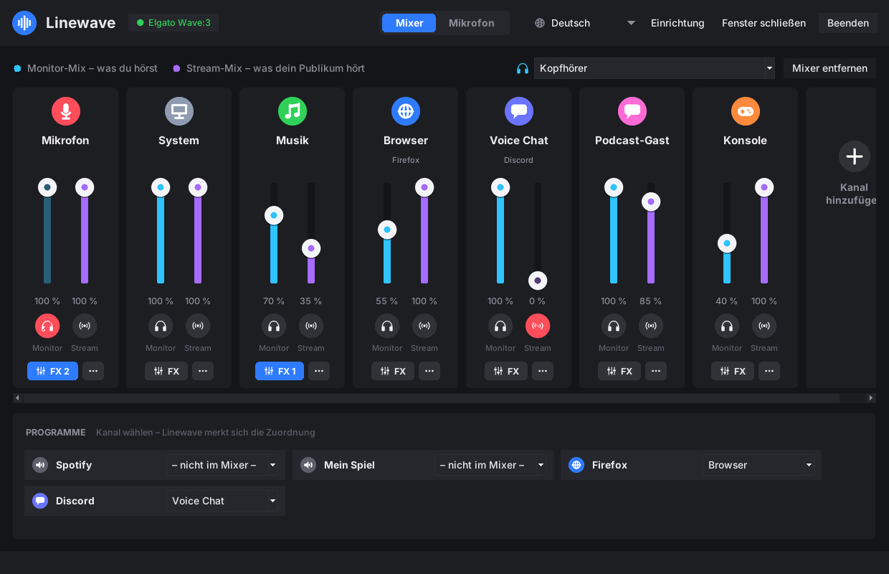 |

Beide starten beim Anmelden unsichtbar und arbeiten im Hintergrund. Über den
jeweiligen Menüeintrag öffnest du das Fenster; schließt du es, läuft das
Programm einfach weiter.

LinDeck und Linewave gibt es auf **Deutsch, Englisch, Spanisch, Französisch und
Portugiesisch (Brasilien)**. Sie richten sich nach der Systemsprache; unter
[Sprachen](#sprachen) steht, wie du sie umstellst oder eine Übersetzung beisteuerst.

### In 3 Schritten loslegen

1. **Installieren:** `lindeck_<version>_all.deb` unter [Releases](../../releases)
   herunterladen und per Doppelklick installieren (Details unter
   [Installation](#installation)).
2. **Stream Deck:** Den Windows-Ordner `ProfilesV3` auf einen USB-Stick kopieren
   und einstecken – LinDeck übernimmt alle Profile von selbst. Ändern kannst du
   sie im Fenster **LinDeck** (Menü).
3. **Audio (optional):** Im Menü **Linewave** öffnen – der Einrichtungsassistent
   fragt nach Mikrofon, Kopfhörer und Kanälen. Danach in OBS als Audioquelle
   „Monitor of Linewave Stream-Mix“ wählen – fertig.

Installiert wird eine einzige `.deb`-Datei. Danach läuft alles automatisch:
Gerätezugriff, virtuelle Tastatur, Autostart und der Import deiner Profile.

> **Status:** Version 0.12 – getestet mit simulierten Geräten aller Modelle und
> den Elgato-Standardprofilen. Tests auf echter Hardware stehen noch aus.

---

## Inhalt

- [Unterstützte Geräte](#unterstützte-geräte)
- [Installation](#installation)
- [Profile übernehmen](#profile-übernehmen)
- [Das LinDeck-Fenster](#das-lindeck-fenster)
- [Linewave](#linewave)
- [Unterstützte Aktionen](#unterstützte-aktionen)
- [Elgato-Plugins](#elgato-plugins)
- [OBS, Spotify, Discord](#obs-spotify-discord)
- [Audio-Mixer (Wave-Link-Ersatz)](#audio-mixer-wave-link-ersatz)
- [Wave-Mikrofon](#wave-mikrofon)
- [Hardware-Selbsttest](#hardware-selbsttest)
- [Befehle](#befehle)
- [Konfiguration](#konfiguration)
- [Sprachen](#sprachen)
- [Fehlersuche](#fehlersuche)
- [Entwicklung](#entwicklung)
- [Aufbau des Projekts](#aufbau-des-projekts)
- [Roadmap](#roadmap)
- [Rechtliches](#rechtliches)

---

## Unterstützte Geräte

| Gerät | Tasten | Besonderheiten |
|---|---|---|
| Stream Deck Original / V2 / MK.2 (inkl. Scissor-Keys, Modul 15) | 15 | |
| Stream Deck Mini / Mini MK.2 (inkl. Discord-Edition, Modul 6) | 6 | |
| Stream Deck XL / XL V2 (inkl. Modul 32) | 32 | |
| Stream Deck Neo | 8 | Infobar (Uhr, Seitenanzeige), 2 Touch-Tasten zum Blättern |
| Stream Deck + | 8 | 4 Dials, Touchstreifen (Tippen, Halten, Wischen) |
| Stream Deck + XL | 36 | 6 Dials, Touchstreifen |
| Stream Deck Studio | 32 | 2 Dials |
| Stream Deck Pedal | 3 Pedale | |

Mehrere Geräte gleichzeitig sowie An- und Abstecken im laufenden Betrieb werden
unterstützt. Profile werden dem passenden Gerät automatisch zugeordnet
(Modellcode, sonst Tastenlayout).

## Installation

**Voraussetzung:** Debian-basierte Distribution mit Python ≥ 3.10
(Debian 12/13, Ubuntu 22.04+, Linux Mint 21+, Pop!_OS, Zorin …), X11 oder Wayland.

1. Die aktuelle `lindeck_<version>_all.deb` unter
   [Releases](../../releases) herunterladen.
2. Doppelklick → **Installieren**, oder im Terminal:

   ```bash
   sudo apt install ./lindeck_0.12.0_all.deb
   ```

Das Paket erledigt automatisch:

- alle Abhängigkeiten über `apt` (die Stream-Deck-Bibliothek ist bereits enthalten)
- udev-Regel für den Gerätezugriff ohne root (`/lib/udev/rules.d/70-lindeck.rules`)
- `uinput`-Modul für Hotkeys unter X11 **und** Wayland
- Autostart bei jeder Anmeldung und sofortiger Start nach der Installation
- Menüeinträge „LinDeck“ und „Linewave“ mit eigenen Symbolen

Falls LinDeck direkt nach der Installation nicht anläuft: einmal ab- und wieder anmelden.

**Deinstallieren:** `sudo apt remove lindeck` – deine Profile unter
`~/.local/share/lindeck` bleiben erhalten.

## Profile übernehmen

### Automatisch (empfohlen)

LinDeck durchsucht alle 15 Sekunden **Downloads**, **Desktop** und
**eingesteckte USB-Sticks** und übernimmt selbstständig:

| Gefunden | Aktion |
|---|---|
| `*.streamDeckProfile` | Profil wird importiert |
| `*.streamDeckProfilesBackup` | alle Profile aus dem Elgato-Backup werden importiert |
| Ordner `ProfilesV2` / `ProfilesV3` (auch als ZIP) | alle Profile werden importiert |
| `Stream_Deck_*.msi` (Elgato-Installer) | Standard-Icons werden übernommen |

Nach jedem Import erscheint eine Desktop-Benachrichtigung. Bereits importierte
Dateien werden kein zweites Mal verarbeitet.

**So kommen alle Profile von Windows rüber:**

1. Unter Windows den Ordner `%APPDATA%\Elgato\StreamDeck\ProfilesV3`
   (ältere Versionen: `ProfilesV2`) auf einen USB-Stick kopieren.
2. Stick unter Linux einstecken – fertig.

Optional zusätzlich den Elgato-Installer (`Stream_Deck_*.msi`) in den
Download-Ordner legen, damit Tasten ohne eigenes Icon die Original-Symbole zeigen.

### Unterstützte Formate

- Profilformat **v1, v2 und v3** (Stream-Deck-App 4.x bis 7.x)
- Einzelne Exporte, komplette Backups und kopierte Profilordner
- Eingebettete Ressourcen (z. B. Soundboard-Dateien aus v3-Exporten)
- Auf **macOS** erstellte Profile (Cmd wird zu Strg umgesetzt)

## Das LinDeck-Fenster

LinDeck ist das Programm für das Stream Deck – wie die Elgato-Stream-Deck-Software:

- **Beim Anmelden** startet LinDeck unsichtbar und steuert das Stream Deck.
- **Menüeintrag „LinDeck“** (oder `lindeck` im Terminal) öffnet das Fenster.
  Läuft LinDeck schon, kommt nur das Fenster nach vorne – es gibt nie zwei
  Instanzen.
- **Fenster schließen** blendet es nur aus; das Stream Deck arbeitet weiter.
- **Beenden** über den Knopf oben rechts, das Symbol in der Taskleiste (falls
  vorhanden, Paket `python3-pystray`) oder `lindeck quit`.
- Der Knopf **Linewave** oben öffnet das zweite Programm für Mixer und Mikrofon.


Oben wählst du das angeschlossene Stream Deck; geöffnet wird das Profil, das
gerade darauf läuft. Wechselst du im Fenster Profil oder Seite, wechselt das
Gerät mit (sofern das Profil zum Gerät passt).

Aufbau wie in der Elgato-App:

- **Mitte:** das Gerät mit allen Tasten, Dials (Stream Deck +, + XL, Studio) und
  der Seitenleiste – die Tasten werden genau so gezeichnet wie auf dem Gerät.
- **Rechts:** alle eingebauten Aktionen nach Kategorien, mit Suchfeld.
- **Unten:** die Eigenschaften der gewählten Taste.

| Was | So geht's |
|---|---|
| Aktion zuweisen | aus der Liste rechts auf eine Taste **ziehen** oder doppelklicken |
| Taste verschieben/tauschen | Taste auf einen anderen Platz ziehen – oder auf eine Seitennummer, um sie auf eine andere Seite zu verschieben |
| Kopieren, Einfügen, Löschen | Rechtsklick auf die Taste oder `Strg+C`, `Strg+X`, `Strg+V`, `Entf` |
| Titel, Schrift, Farbe, Position | im Bereich **Darstellung** (pro Zustand, z. B. bei Hotkey Switch) |
| Eigenes Icon | **Bild wählen…** (PNG, JPG, SVG, animiertes GIF) – **Standard** stellt das Original wieder her |
| Hotkey aufnehmen | ins Hotkey-Feld klicken und die Kombination drücken, oder **Eingeben…** (z. B. `Strg+Umschalt+T`) |
| Ordner | Aktion „Ordner“ ablegen, per Doppelklick öffnen, mit **↩ Zurück** wieder verlassen |
| Multi Action, Key Logic, Dial Stack … | Schritte unter **Enthaltene Aktionen** hinzufügen, bearbeiten, sortieren; Verzögerungen einfügen |
| Seiten | **+** / **−** fügt Seiten hinzu bzw. entfernt sie, **◀ ▶** ändert die Reihenfolge |
| Rückgängig | `Strg+Z` / `Strg+Y` oder **↶ ↷** |
| Profile | **Neu…** (mit Gerätemodell), Duplizieren, Umbenennen, Löschen, Importieren, Exportieren |
| Plugin-Aktionen | bleiben erhalten; Titel, Icon und Rohdaten (**Einstellungen (JSON)…**) sind bearbeitbar |

Jede Änderung wird **sofort gespeichert** und das Profil automatisch neu geladen, sodass das Stream Deck die Änderung nach ein bis zwei
Sekunden zeigt. Gespeichert wird im Originalformat der Elgato-App – unbekannte
Einstellungen (z. B. von Plugins) bleiben unverändert erhalten. **Exportieren…**
erzeugt eine `.streamDeckProfile`-Datei, z. B. als Sicherung oder für einen
anderen Rechner.

Tasten ohne eigenes Icon zeigen die Elgato-Standardsymbole, sobald der
Elgato-Installer übernommen wurde (siehe oben); sonst erscheint der Aktionsname.

### Hintergrundbilder

Unter dem Gerät öffnet **Hintergrund** die Einstellungen der aktuellen Seite:

- **Bild wählen …** verteilt ein Foto oder Bild über alle Tasten der Seite –
  wie ein Desktop-Hintergrund. Die Lücken zwischen den Tasten sind
  eingerechnet, sodass das Bild auf dem Gerät durchgehend wirkt. Leere Tasten
  zeigen das Bild, Tasten mit eigenem Symbol liegen darüber (Symbole mit
  durchsichtigem Hintergrund wirken am besten).
- **Abdunkeln** macht das Bild dunkler, damit Titel lesbar bleiben.
- **Auf alle Seiten übernehmen** setzt dasselbe Bild auf jeder Seite des Profils.
- **Touchstreifen** (Stream Deck +, + XL): eigenes Bild für den ganzen Streifen –
  dasselbe Format wie in der Elgato-App, bleibt also beim Export erhalten.

| Seite mit Hintergrundbild | Einstellungen |
|---|---|
| 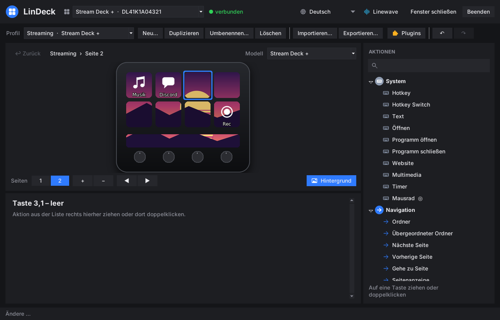 | 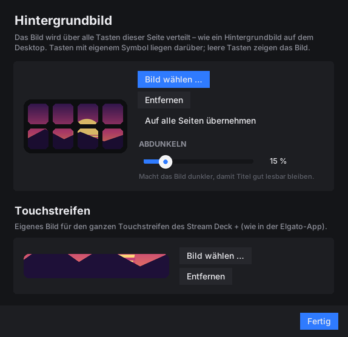 |

Das Tastenbild speichert LinDeck im Profil unter `LinDeckBackground`; die
Elgato-App ignoriert diesen Eintrag, öffnet das Profil also weiterhin normal.

## Unterstützte Aktionen

Alle eingebauten Aktionen der Elgato-App sind nachgebaut:

| Elgato-Aktion | Umsetzung unter Linux |
|---|---|
| **Hotkey**, **Hotkey Switch** | virtuelle Tastatur über `uinput`; Tastaturlayout (DE/US) wird berücksichtigt; auf Dials: Links-/Rechtsdrehung, Drücken, Tippen |
| **Text** | Einfügen über die Zwischenablage (inkl. Emojis), Tippmodus, „Enter senden“ |
| **Multimedia** | Medientasten bzw. `playerctl`; auf Dials: Systemlautstärke mit Anzeige |
| **Open**, **Open Application**, **Close** | Dateien, Ordner, URLs und Programme; Windows-Programme werden automatisch auf Linux-Gegenstücke abgebildet (Chrome, Firefox, Discord, Spotify, Steam, OBS, VS Code, Teams …); langes Drücken = Programm beenden |
| **Website** | Standardbrowser oder gewählter Browser |
| **Multi Action**, **Multi Action Switch**, **Random Action**, **Delay** | wie im Original |
| **Ordner**, **Übergeordneter Ordner** | beliebig verschachtelt |
| **Seiten** (weiter, zurück, gehe zu, Seitenanzeige) | inkl. Wischen auf dem Touchstreifen und Neo-Touch-Tasten |
| **Profil wechseln** | gezielt oder reihum |
| **Helligkeit**, **Sleep** | Tasten und Dials; erster Tastendruck weckt nur auf; optional automatisches Schlafen |
| **Timer** | Start/Pause, langes Drücken setzt zurück, Alarm |
| **Soundboard** (Play Audio, Stop Audio) | Überlappen, Stopp, Neustart, Schleife, Lautstärke |
| **Key Logic** | Tippen, Doppeltippen, Halten |
| **Action Wheel**, **Dial Stack**, **Action Trigger**, **Mouse Wheel** | Dial-Aktionen von Stream Deck + / + XL / Studio |
| **Digital Time**, **Pagination** | Neo-Infobar |
| **Volume Controller** (Ein-/Ausgabegeräte, App-Lautstärke) | PipeWire/PulseAudio |
| **Smart Profiles** | automatischer Profilwechsel nach aktivem Fenster (X11, KDE mit `kdotool`, Hyprland, Sway) |

Animierte GIFs, SVG-Icons, Titel mit Schriftart, -größe, -farbe, Ausrichtung,
Unterstreichung und Kontur werden wie in der Elgato-App dargestellt.

**Plugins von Drittanbietern:** OBS, Spotify, Discord und Wave Link setzt LinDeck
selbst um (siehe unten), andere Plugins laufen über den eingebauten
[Plugin-Host](#elgato-plugins). Aktionen von Plugins, die unter Linux nicht laufen,
werden mit ihrem gespeicherten Icon angezeigt; beim Drücken erscheint ein
Warnsymbol. `lindeck report` zeigt, welche Plugins deine Profile verwenden und
welche davon unterstützt sind.

## Elgato-Plugins

LinDeck enthält einen Plugin-Host für das offizielle Stream-Deck-SDK
(WebSocket-Protokoll). Plugins installieren:

- im LinDeck-Fenster auf **Plugins** → **Plugin installieren …** und die
  heruntergeladene `.streamDeckPlugin`-Datei wählen,
- die Datei einfach in den Download-Ordner legen (wird automatisch installiert)
  oder
- `lindeck plugin install <Datei.streamDeckPlugin>`

Die **Plugin-Verwaltung** zeigt jedes Plugin mit Symbol, Version und Status
(läuft, startet, beendet, nicht lauffähig) und ob Node.js installiert ist. Dort
lassen sich Plugins neu starten, ihr Log öffnen oder entfernen; **Marketplace
öffnen** führt zu den Elgato-Plugins.

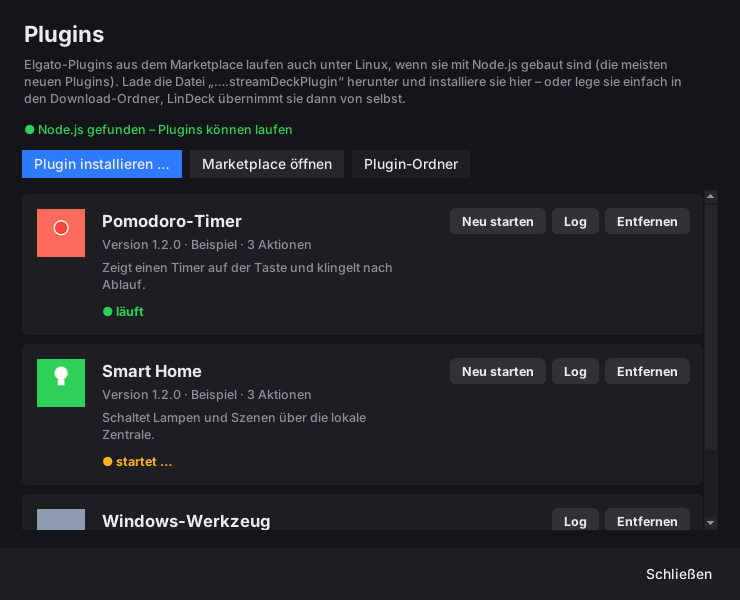

| Plugin-Art | unter Linux |
|---|---|
| Node.js-Plugins (alle mit dem offiziellen SDK ab Stream Deck 6.4 gebauten) | laufen mit dem System-Node.js (Paket `nodejs`, Version 20 empfohlen) |
| Plugins mit `CodePathLin` im Manifest (Linux-Programm) | laufen direkt |
| reine Windows-/macOS-Programme (`.exe`, macOS-Binärdateien) | nicht lauffähig – `lindeck plugin list` zeigt das an |
| ältere HTML/JavaScript-Plugins | nicht lauffähig |

Unterstützt werden Tasten, Dials und Touchstreifen: `keyDown`/`keyUp`,
`willAppear`/`willDisappear`, `dialRotate`/`dialDown`/`dialUp`, `touchTap`,
`setTitle`, `setImage` (PNG/JPG/SVG), `setState`, `showAlert`/`showOk`,
`setSettings`/`getSettings` (wird im Profil gespeichert), globale Einstellungen,
`setFeedback`, `openUrl`, `switchToProfile`, `logMessage`. Die Aktionen
installierter Plugins erscheinen im LinDeck-Fenster in der Aktionsliste. Plugin-Logs
liegen unter `~/.local/state/lindeck/plugins/`. Plugins erfahren die Sprache von
LinDeck und zeigen mehrsprachige Texte in derselben Sprache.

**Einstellungsseiten (Property Inspector):** Im LinDeck-Fenster öffnet
**Einstellungsseite…** die HTML-Einstellungen des Plugins wie in der
Elgato-App – in einem schlanken Chromium-/Chrome-Fenster, sonst im
Standardbrowser. Änderungen speichert das Plugin sofort im Profil; das Fenster
übernimmt sie automatisch. Die Seite wird
nur lokal (127.0.0.1) und mit einem zufälligen Zugangsschlüssel ausgeliefert;
fremde Webseiten können sich nicht mit dem Plugin-Host verbinden. Alternativ
lassen sich die Einstellungen weiterhin als JSON bearbeiten.

## OBS, Spotify, Discord

Diese Plugins sind in LinDeck nachgebaut. Tasten aus importierten Elgato-Profilen
werden automatisch zugeordnet; neue legst du im LinDeck-Fenster an (Kategorien
„OBS Studio“, „Spotify & Medien“, „Discord“).

**OBS Studio** (über obs-websocket, in OBS ab Version 28 enthalten): Szene
wechseln, Aufnahme (auch Pause), Stream, Quelle ein/aus, Audio-Eingang
stumm/Lautstärke per Dial, Replay-Puffer, virtuelle Kamera, Studio-Modus,
Übergang, Screenshot. Tasten zeigen den Zustand live (z. B. Aufnahme läuft).

1. In OBS: *Werkzeuge → WebSocket-Server-Einstellungen → WebSocket-Server aktivieren*
2. Passwort in `config.json` eintragen: `"obs": {"password": "…"}`
3. `lindeck obs` prüft die Verbindung.

Bei importierten Tasten des Elgato-OBS-Plugins nutzt LinDeck die gespeicherten
Einstellungen und – falls dort kein Name steht – den Tastentitel als Szenen-
bzw. Quellennamen.

**Spotify und andere Player** (über MPRIS/`playerctl`): Wiedergabe/Pause,
vor/zurück, aktueller Titel, Zufall, Wiederholen, Lautstärke (auch per Dial).
Funktioniert mit jedem MPRIS-Player (Spotify, VLC, Firefox, Rhythmbox …).

**Discord** (über die lokale RPC-Schnittstelle der Desktop-App): Mikrofon stumm,
Ton aus, Push to Talk/Mute, Sprachkanal betreten/verlassen, Textkanal öffnen.
Discord erlaubt das nur angemeldeten Apps – einmalig einrichten:

1. Auf https://discord.com/developers/applications eine App anlegen („New Application“).
2. Unter *OAuth2* die Redirect-URL `http://localhost` eintragen.
3. Client-ID und Client-Secret in `config.json`:
   `"discord": {"client_id": "…", "client_secret": "…"}`
4. `lindeck discord` ausführen und die Anfrage in Discord bestätigen.

## Linewave

Das zweite Programm – der Ersatz für Elgato Wave Link. Menüeintrag
**Linewave** oder `linewave`; auch hier gibt es nur eine Instanz, und
„Fenster schließen“ blendet nur aus. Beenden: Knopf oben rechts, Taskleiste
oder `linewave --quit`.

### Einrichtung beim ersten Start

Beim ersten Öffnen führt ein Assistent durch alles Wichtige – wie bei Wave Link:

1. **Mikrofon** wählen – ein Elgato Wave wird markiert; die Pegelanzeige zeigt
   beim Sprechen, ob das Mikrofon ankommt.
2. **Kopfhörer/Lautsprecher** wählen – mit **Testton**.
3. **Klang:** Low Cut, Clipguard, beim Wave:3 der Gain, dazu empfohlene Effekte
   (Rauschunterdrückung, Noise Gate, Kompressor – je nachdem, was installiert ist).
4. **Kanäle** auswählen.
5. **Fertig:** Linewave richtet den Mixer ein und zeigt, was in OBS und Discord
   einzustellen ist.

Über **Einrichtung** oben im Fenster lässt sich der Assistent jederzeit erneut
öffnen; **Später einrichten** überspringt ihn.

| Mikrofon wählen | Klang einstellen |
|---|---|
| 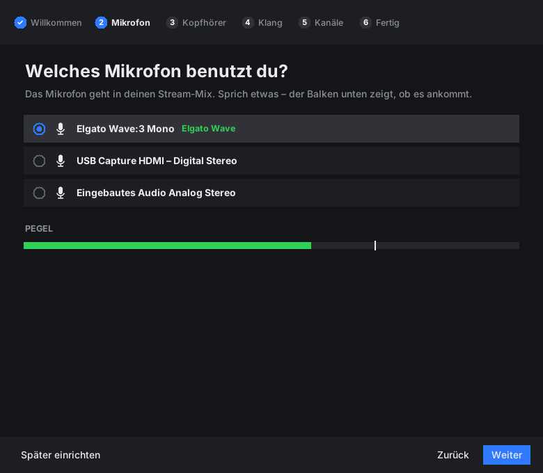 | 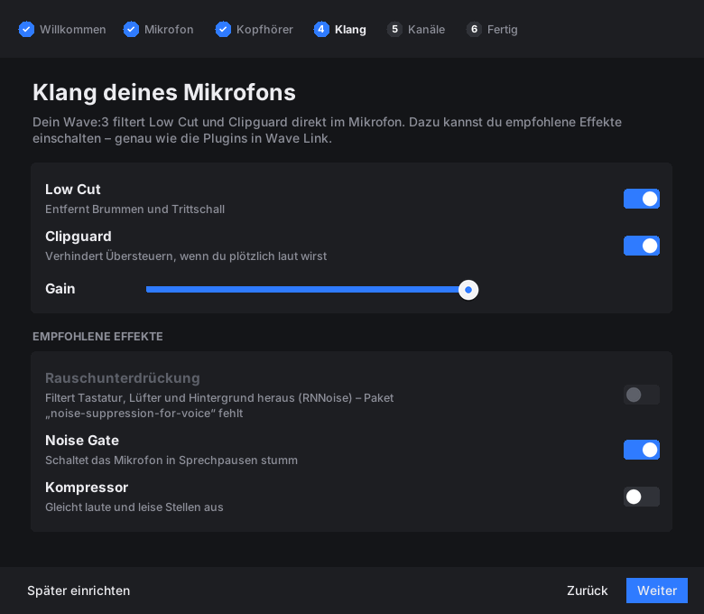 |

- **Mixer:** je Kanal zwei Regler (Monitor/Stream) mit Stumm-Schalter,
  Monitor-Ausgang (Kopfhörer) wählen, und unter **Programme** jedes laufende
  Programm per Auswahlliste in einen Kanal legen – die Zuordnung wird gemerkt.
  „Mixer einrichten“/„Mixer entfernen“ schaltet den Mixer ein und aus.
- **Mikrofon:** Gain, Stumm, Low Cut, Clipguard; beim Wave:3 zusätzlich LEDs
  aus/umkehren, Kopfhörer-Lautstärke und Mithören.

| Reiter „Mixer“ | Reiter „Mikrofon“ |
|---|---|
|  | 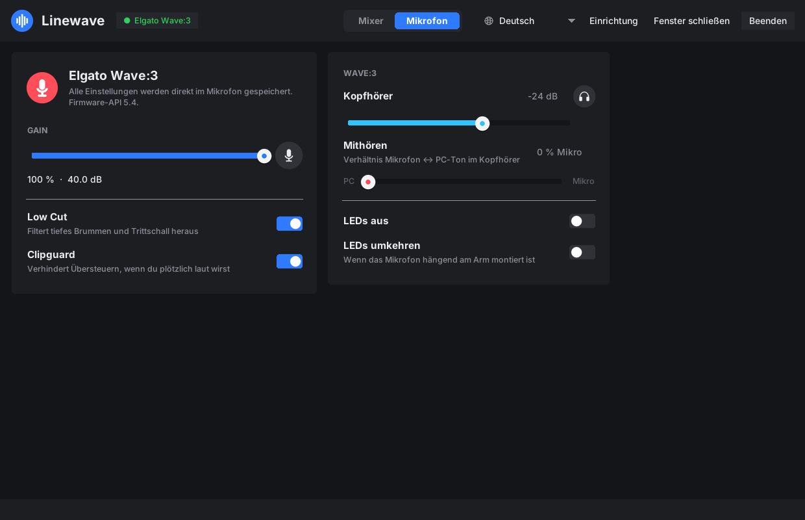 |

Im Hintergrund richtet Linewave den Mixer nach dem Anmelden ein, verteilt
neue Programme auf die Kanäle und betreibt die Software-Filter für Wave-Mikrofone
ohne eingebaute Filter. Tasten auf dem Stream Deck (Mixer-Kanal, Wave-Mikrofon)
funktionieren auch, wenn Linewave gerade nicht läuft.

**So heißt alles unter Linux:** In den Klangeinstellungen, in `pavucontrol`
und in OBS erscheinen die Kanäle als **„Linewave System“, „Linewave Musik“,
„Linewave Browser“, „Linewave Voice Chat“, „Linewave Spiel“, „Linewave Effekte“**
und **„Linewave Stream-Mix“**, das gefilterte Mikrofon als **„Linewave Mikrofon“**.
Die internen Verbindungen heißen z. B. „Linewave Musik → Stream-Mix“.
(Bis Version 0.6 hieß jeder Kanal nur „LinDeck“ – beim ersten Start räumt
Linewave die alten Kanäle auf und legt sie mit den richtigen Namen neu an.)

<p align="center">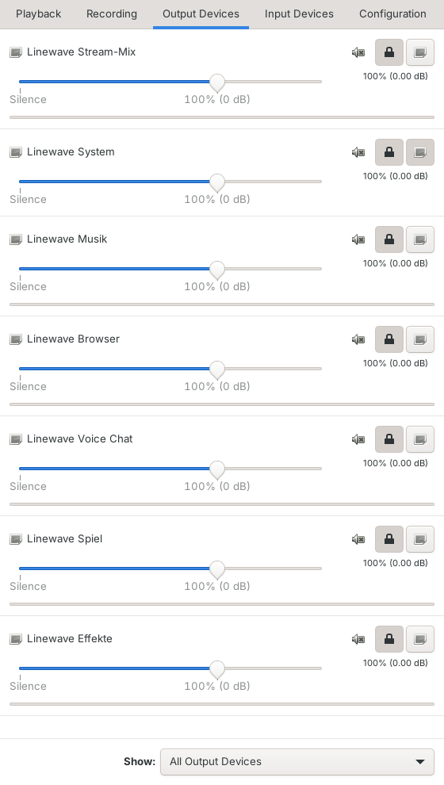</p>

### Eigene Kanäle

Rechts neben den Kanälen legt **Kanal hinzufügen** einen neuen Kanal an – mit
Name, Symbol und Farbe. Zwei Arten gibt es:

- **Programme:** ein weiterer Kanal wie „Musik“ oder „Spiel“, z. B. „Podcast-Gast“
  oder „Zweites Spiel“. Programme legst du unter **Programme** hinein.
- **Eingangsgerät:** holt ein Gerät direkt in den Mix – ein zweites Mikrofon,
  Line-In oder eine Capture-Karte (Konsole, Kamera). Wie jeder Kanal mit
  eigenem Regler für Monitor und Stream.

Über **•••** unter einem Kanal änderst du Name, Symbol, Farbe oder Gerät oder
löschst ihn; auch die mitgelieferten Kanäle lassen sich umbenennen oder löschen.
Lautstärken bleiben dabei erhalten. Im Terminal: `linewave mixer add "Podcast-Gast"`,
`linewave mixer add Konsole "USB Capture"` (Eingangsgerät) und
`linewave mixer delete <Kanal>`.

<p align="center">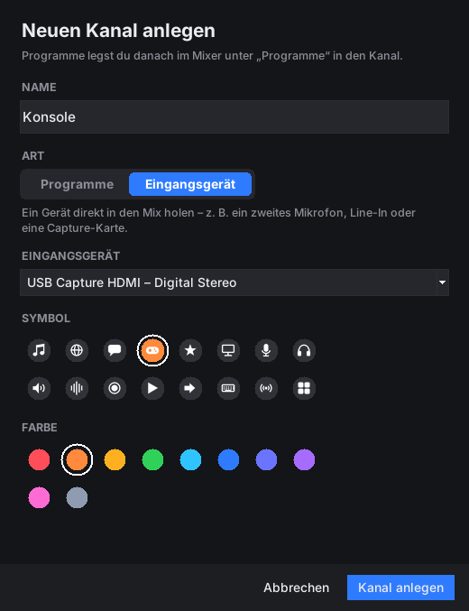</p>

### Effekte (Plugins)

Wie die Plugins in Wave Link: **FX** unter einem Kanal öffnet seine
Effektkette – für Programm-Kanäle, eigene Eingänge und das Mikrofon. Der Ton
läuft von oben nach unten durch die Effekte; jeder lässt sich an- und
ausschalten, verschieben und mit Reglern einstellen. Regler wirken sofort.

| Effekt | woher |
|---|---|
| Hochpass (Low Cut), Tiefpass, Bass, Höhen, EQ-Band | in PipeWire eingebaut – immer da |
| Rauschunterdrückung (RNNoise) | Paket `noise-suppression-for-voice` bzw. dessen LADSPA-Datei |
| Noise Gate, Kompressor, Limiter | Paket `swh-plugins` (wird mit LinDeck empfohlen) |
| Equalizer, De-Esser, Hall | Paket `tap-plugins` |
| alle weiteren LADSPA-Plugins | werden automatisch gefunden (`/usr/lib/ladspa`, `~/.ladspa`, `LADSPA_PATH`) |
| **LV2-Plugins** – z. B. x42 (Kompressor, EQ, Limiter), LSP, Calf, Noise Repellent | Pakete `x42-plugins`, `lsp-plugins-lv2`, `calf-plugins` …; gefunden über `lilv-utils` (`/usr/lib/lv2`, `~/.lv2`, `LV2_PATH`) |

**LV2 auf jedem System:** Kann das installierte PipeWire selbst LV2-Plugins
laden (z. B. Fedora, Arch), laufen sie direkt in der Filterkette. Sonst – etwa
bei Ubuntu 24.04 – startet Linewave jedes LV2-Plugin mit `jalv` über
pipewire-jack und verkabelt die Kette automatisch mit `pw-link`; dafür werden
die Pakete `jalv` und `pipewire-jack` gebraucht (vom LinDeck-Paket empfohlen).
Regler wirken in beiden Fällen sofort. In der Effekt-Auswahl lassen sich die
Plugins nach **Eingebaut**, **LADSPA** und **LV2** filtern. Plugins, die eine
eigene Oberfläche, MIDI oder Steuersignale brauchen (Instrumente, Pegelanzeigen),
werden ausgeblendet.

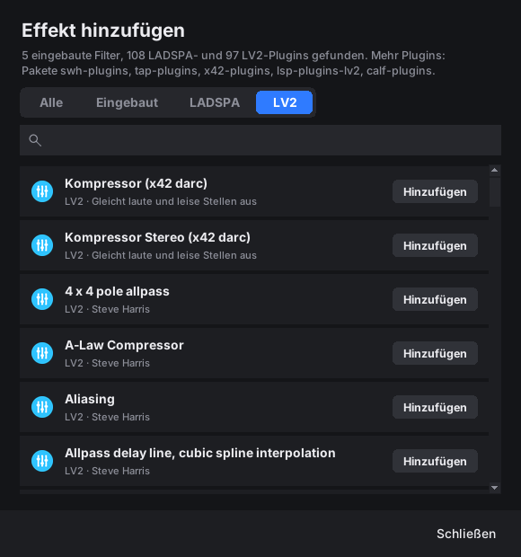

Ein Kanal mit Effekten erscheint unter Linux zusätzlich als Quelle
„Linewave <Kanal> (Effekte)“. Stürzt ein Plugin ab, startet Linewave die
Effektkette neu; startet sie gar nicht, läuft der Kanal ohne Effekte weiter.

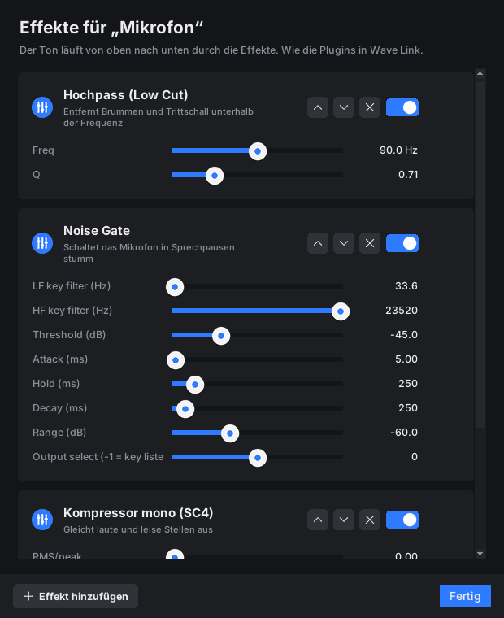

## Audio-Mixer (Wave-Link-Ersatz)

Wie Elgato Wave Link, auf Basis von PipeWire: Programme laufen in virtuellen
Kanälen (System, Musik, Browser, Voice Chat, Spiel, Effekte, Mikrofon), und jeder
Kanal hat zwei unabhängige Regler:

- **Monitor-Mix** – was du auf Kopfhörer/Lautsprechern hörst
- **Stream-Mix** – was dein Publikum hört; in OBS als Audioquelle
  „Monitor of Linewave Stream-Mix“ wählen

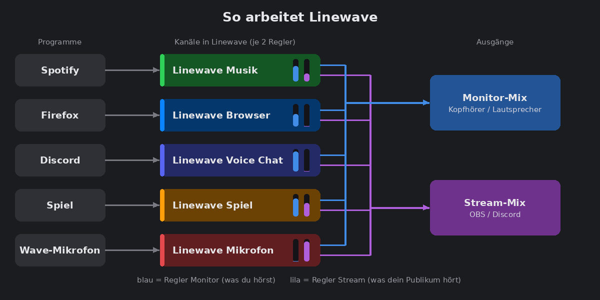

Beispiel: Musik soll im Kopfhörer laut sein, im Stream aber leise → beim Kanal
„Musik“ den Regler **Monitor** hoch und **Stream** runter. Dein eigenes Mikrofon
hörst du standardmäßig nicht im Kopfhörer (Monitor stumm), im Stream ist es an.

```bash
linewave mixer setup                   # einrichten (oder im Fenster von Linewave)
linewave mixer                         # Übersicht aller Kanäle
linewave mixer set music stream 40     # Musik im Stream auf 40 %
linewave mixer assign spotify music    # Programm dauerhaft einem Kanal zuordnen
linewave mixer output                  # Monitor-Mix auf das nächste Ausgabegerät
linewave mixer remove                  # alles entfernen
```

Bekannte Programme (Spotify, Browser, Discord, Steam …) werden automatisch dem
passenden Kanal zugeordnet, alles andere landet in „System“. Auf dem Stream Deck:
Aktion **Mixer-Kanal** (Taste: stumm/lauter/leiser, Dial: Lautstärke, Drücken:
stumm) und **Monitor-Ausgang**. Tasten des Elgato-Wave-Link-Plugins aus
importierten Profilen werden auf den Mixer abgebildet. Voraussetzung: PipeWire
mit `pipewire-pulse` (Standard bei aktuellen Distributionen).

## Wave-Mikrofon

**Elgato Wave:3** – alle Einstellungen direkt im Mikrofon, wie mit Wave Link:

| Funktion | Befehl |
|---|---|
| Gain (0–40 dB), Stumm | `linewave mic gain 70` (Prozent), `linewave mic mute` |
| Low Cut, Clipguard (im Mikrofon) | `linewave mic lowcut on`, `linewave mic clipguard on` |
| LEDs ein/aus | `linewave mic leds off` |
| LEDs umkehren (Mikrofon hängend am Arm) | `linewave mic flip on` |
| Kopfhörer-Lautstärke (−60 … 0 dB) | `linewave mic headphone -20` |
| Mithören Mikrofon/PC (0–100 %) | `linewave mic monitor 50` |

Das Wave:3 hat keine einstellbare LED-Farbe oder -Helligkeit, nur „LEDs aus“ und
„umkehren“. Grundlage ist die öffentliche Protokoll-Analyse von
[elgato-wave3-ubuntu](https://github.com/KailasMahavarkar/elgato-wave3-ubuntu)
(MIT-Lizenz). LinDeck liest nach jeder Änderung zurück und nimmt sie
zurück, falls das Mikrofon unerwartet reagiert. Der Ton läuft dabei ungestört
weiter. Zugriff erhält der angemeldete Benutzer über die mitgelieferte udev-Regel.

**Wave:1, Wave Neo, Wave XLR** – Gain und Stumm über die USB-Audio-Steuerung;
Low Cut (80/120 Hz) und Clipguard per PipeWire-Filter (Clipguard braucht
`swh-plugins`). Das bearbeitete Signal erscheint als Mikrofon **„Linewave Mikrofon“**.
LED-Steuerung ist für diese Modelle nicht möglich (Protokoll nicht dokumentiert).

Auf dem Stream Deck: Aktion **Wave-Mikrofon** (Stumm, Gain, Low Cut, Clipguard,
LEDs; Dial: Gain). `linewave mic` zeigt den aktuellen Zustand.

## Hardware-Selbsttest

`lindeck selftest --stop-daemon` prüft jedes angeschlossene Stream Deck Schritt
für Schritt: Display und Helligkeit, jede Taste, jeden Dial (links, rechts,
drücken), jedes Feld des Touchstreifens samt Wischen und die Neo-Touch-Tasten.
Der Bericht landet in `~/.local/state/lindeck/selftest-*.txt` – bitte bei
Problemen (oder als Erfolgsmeldung für ein noch ungetestetes Modell) an ein
Issue anhängen.

## Befehle

Für den normalen Betrieb ist kein Befehl nötig. Für Sonderfälle:

| Befehl | Zweck |
|---|---|
| `lindeck` | LinDeck-Fenster öffnen (startet LinDeck, falls es nicht läuft) |
| `lindeck edit [Profil]` | Fenster öffnen, optional mit einem bestimmten Profil |
| `lindeck run` | unsichtbar starten (so startet der Autostart) |
| `lindeck run --no-gui` | nur die Gerätesteuerung ohne Fenster (z. B. per SSH) |
| `lindeck quit` | LinDeck beenden |
| `lindeck import <Datei/Ordner>` | Profile manuell importieren |
| `lindeck profiles` | importierte Profile anzeigen |
| `lindeck devices` | angeschlossene Geräte mit Seriennummer und Firmware |
| `lindeck assign <Seriennr.> <Profil>` | Profil fest einem Gerät zuordnen |
| `lindeck report [Profil]` | Kompatibilitätsbericht: Plugins und fehlende Programmzuordnungen |
| `lindeck preview <Profil> -o <Ordner> [--all]` | Seiten als PNG rendern, ohne Gerät |
| `lindeck extract-assets <Stream_Deck.msi>` | Standard-Icons manuell übernehmen |
| `lindeck remove <Profil>` | Profil löschen |
| `lindeck plugin [list\|install\|remove]` | Elgato-Plugins verwalten |
| `linewave` | Linewave öffnen (`--hidden`: unsichtbar, `--quit`: beenden) |
| `linewave mixer add <Name> [Eingangsgerät]` · `linewave mixer delete <Kanal>` | eigenen Kanal anlegen bzw. löschen |
| `linewave mixer [status\|setup\|remove\|set\|mute\|assign\|output]` | Audio-Mixer (Wave-Link-Ersatz) |
| `linewave mic [status\|gain\|mute\|lowcut\|clipguard\|leds\|flip\|headphone\|monitor]` | Wave-Mikrofon |
| `lindeck obs` | Verbindung zu OBS prüfen |
| `lindeck discord` | Discord verbinden (einmalige Freigabe) |
| `lindeck selftest [--stop-daemon]` | Hardware-Selbsttest |
| `lindeck reload` | Profile und Konfiguration neu laden |
| `lindeck -v run` | mit ausführlichem Log starten |

Profile und Konfiguration werden bei Änderungen automatisch neu geladen.

## Konfiguration

Optional: `~/.config/lindeck/config.json`

```json
{
  "language": "auto",
  "brightness": 70,
  "sleep_after_minutes": 0,
  "keyboard_layout": "auto",
  "path_map": { "C:/Users/Felix/Music": "/home/felix/Musik" },
  "app_map":  { "obs64.exe": "flatpak run com.obsproject.Studio", "Spotify": "spotify" },
  "smart_profiles": { "obs": "<Profil-ID>" },
  "soundboard_output": "",
  "long_press_ms": 500,
  "double_press_ms": 300,
  "devices": { "<Seriennummer>": { "profile": "<Profil-ID>" } },
  "obs": { "host": "127.0.0.1", "port": 4455, "password": "" },
  "discord": { "client_id": "", "client_secret": "" },
  "mixer": { "enabled": false, "monitor_output": "", "mic": "", "routes": { "spotify": "music" } },
  "wave_mic": { "lowcut": false, "lowcut_freq": 80, "clipguard": false, "set_default": true },
  "node_path": ""
}
```

| Schlüssel | Bedeutung |
|---|---|
| `language` | Sprache der Oberfläche: `auto` (Systemsprache), `de`, `en`, `es`, `fr`, `pt_BR` |
| `brightness` | Standardhelligkeit in Prozent |
| `sleep_after_minutes` | Gerät nach X Minuten ohne Eingabe abschalten (`0` = nie) |
| `keyboard_layout` | Layout, mit dem die Profile unter Windows erstellt wurden: `auto`, `de`, `us` |
| `path_map` | Windows-Pfade auf Linux-Pfade umbiegen (Präfix-Ersetzung) |
| `app_map` | Windows-Programme oder App-Namen auf Linux-Befehle abbilden |
| `smart_profiles` | Fensterklasse → Profil-ID, zusätzlich zur Automatik |
| `soundboard_output` | PipeWire-Ausgabe für das Soundboard (leer = Standard) |
| `long_press_ms`, `double_press_ms` | Zeitschwellen für Halten und Doppeltippen |
| `devices` | feste Profilzuordnung je Gerät |
| `obs` | Verbindung zu obs-websocket |
| `discord` | eigene Discord-App für die RPC-Steuerung |
| `mixer` | Audio-Mixer: aktiv, Monitor-Ausgang, Mikrofon, Programm → Kanal (`system`, `music`, `browser`, `voice`, `game`, `sfx`), eigene Kanäle über `channels` |
| `wave_mic` | Startwerte für Low Cut/Clipguard |
| `node_path` | Node.js für Plugins (leer = `node` aus dem Pfad) |

**Dateien:**

| Pfad | Inhalt |
|---|---|
| `~/.local/share/lindeck/profiles/` | importierte Profile (Elgato-Format) |
| `~/.local/share/lindeck/resources/` | eingebettete Ressourcen (z. B. Sounds) |
| `~/.local/share/lindeck/elgato-assets/` | Standard-Icons aus dem Elgato-Installer |
| `~/.local/share/lindeck/plugins/` | installierte Elgato-Plugins |
| `~/.local/state/lindeck/state.json` | zuletzt aktives Profil, Seite, Helligkeit je Gerät |
| `~/.local/state/lindeck/lindeck.log` | Log |

## Sprachen

LinDeck und Linewave sprechen **Deutsch, English, Español, Français und
Português (Brasil)**. Standardmäßig richten sie sich nach der Systemsprache
(`LANGUAGE`, `LC_ALL`, `LC_MESSAGES`, `LANG`); ohne passende Übersetzung
erscheint Englisch.

- **Umstellen:** oben im Fenster von LinDeck oder Linewave auf den Knopf mit
  dem Globus klicken und eine Sprache wählen (oder „Systemsprache“). Beide
  Programme teilen sich die Einstellung; das Programm bietet gleich einen
  Neustart an.
- **Für einen Start:** `LINDECK_LANG=fr lindeck` oder `LINDECK_LANG=es linewave`.
- **In der Konfiguration:** `"language": "de"` in `~/.config/lindeck/config.json`.

Auch die Linux-Namen der Mixer-Kanäle („Linewave Musik“ …) und die Sprache, die
Elgato-Plugins mitgeteilt wird, richten sich nach der gewählten Sprache.

### Übersetzung ergänzen oder verbessern

Die Texte liegen als gewöhnliche gettext-Dateien in
[`lindeck/locale/`](lindeck/locale/) – Poedit, Weblate oder ein Texteditor genügen:

1. Die Vorlage `lindeck/locale/lindeck.pot` nach `lindeck/locale/<Code>.po`
   kopieren (z. B. `it.po`, `pl.po`, `ja.po`) – oder eine vorhandene `.po`-Datei
   öffnen, um sie zu verbessern.
2. Die `msgstr`-Zeilen ausfüllen; Platzhalter wie `{name}` unverändert lassen.
3. Prüfen: `python3 tools/i18n.py check <Code>`.
4. Als Pull Request einreichen – die neue Sprache erscheint dann automatisch in
   den Sprachmenüs.

Im Code ist Englisch die Ausgangssprache: Jeder sichtbare Text steht in `_()`
(`from .i18n import _`); `python3 tools/i18n.py update` aktualisiert Vorlage und
alle `.po`-Dateien. Ein Test prüft, dass jede Sprache vollständig ist.

## Fehlersuche

| Problem | Lösung |
|---|---|
| Gerät wird nicht erkannt | `lindeck devices` ausführen; Gerät ab- und wieder anstecken; nach der Installation einmal neu anmelden |
| Display zeigt „Profil fehlt“ | Es gibt noch kein Profil für dieses Modell – Profil in Downloads legen oder USB-Stick einstecken |
| Hotkeys funktionieren nicht | `ls -l /dev/uinput` prüfen; neu anmelden; im Log nach „uinput“ suchen |
| Programm startet nicht | `lindeck report` zeigt fehlende Zuordnungen → in `app_map` eintragen |
| Falsche Zeichen bei Hotkeys | `keyboard_layout` auf das Windows-Layout setzen (`de` oder `us`) |
| Taste zeigt Warnsymbol | Plugin nicht installiert oder nur für Windows/macOS (`lindeck report`, `lindeck plugin list`); bei OBS/Discord: Verbindung prüfen (`lindeck obs`, `lindeck discord`) |
| OBS-Tasten zeigen „OBS offline“ | WebSocket-Server in OBS aktivieren, Passwort in `config.json` |
| Kein Ton nach `mixer setup` | `linewave mixer` prüfen; Monitor-Ausgang mit `linewave mixer output` wählen; `linewave mixer remove` stellt alles zurück |
| Falsche Sprache | siehe [Sprachen](#sprachen); `LINDECK_LANG=de lindeck` erzwingt Deutsch |

Log ansehen: `tail -f ~/.local/state/lindeck/lindeck.log`

## Entwicklung

### Aus dem Quellcode starten

```bash
sudo apt install python3-pil python3-pil.imagetk python3-tk python3-evdev python3-cairosvg libhidapi-libusb0
pip install --user "streamdeck>=0.10"
python3 -m lindeck -v           # LinDeck mit Fenster
python3 -m lindeck -v run --no-gui   # nur Gerätesteuerung
```

### `.deb` bauen

```bash
pip install --user "streamdeck>=0.10"
./packaging/build-deb.sh            # Ergebnis: dist/lindeck_<version>_all.deb
```

Das Script bündelt die Bibliothek
[python-elgato-streamdeck](https://github.com/abcminiuser/python-elgato-streamdeck)
unter `/opt/lindeck/vendor`, damit das Paket ohne pip auskommt.

**Automatischer Build:** Bei jedem Tag `v*` baut die GitHub-Action
[`build-deb.yml`](.github/workflows/build-deb.yml) das Paket und hängt es an ein
Release an. Ein manueller Build ist über *Actions → Build .deb → Run workflow* möglich;
mit der Option „Release anlegen“ entsteht dabei direkt der Release `v<Version>`
(Version aus `lindeck/__init__.py`).

```bash
git tag v0.12.0 && git push origin v0.12.0
```

### Tests

Die Tests laufen mit simulierten Geräten aller Modelle (Dummy-Transport der
Stream-Deck-Bibliothek) und benötigen Elgato-Profile als Testdaten, z. B. die
Standardprofile aus dem Elgato-Installer:

```bash
msiextract -C /tmp/sd Stream_Deck_*.msi
LINDECK_TEST_PROFILES=/tmp/sd/PFiles64/Elgato/StreamDeck/DefaultProfiles \
  python3 -m pytest -q tests
```

Ohne `LINDECK_TEST_PROFILES` werden diese Tests übersprungen.

Die Editor-Tests (`tests/test_editor.py`) brauchen keine Elgato-Profile; die
Oberflächentests laufen mit einem Display, z. B. virtuell:

```bash
sudo apt install xvfb
xvfb-run -a python3 -m pytest -q tests/test_editor.py
```

`tests/test_integrations.py` prüft Plugin-Host, Einstellungsseiten, OBS, Discord,
Mixer, Wave-Mikrofon und Selbsttest gegen simulierte Gegenstellen. Mit
`LINDECK_BROWSER_TEST=1` (und global installiertem Playwright) läuft zusätzlich
eine Plugin-Einstellungsseite in einem echten Chromium. Die Oberflächentests
laufen auf Deutsch (`tests/conftest.py`); `tests/test_i18n.py` prüft die
Übersetzungen.

## Aufbau des Projekts

```
lindeck/
├── __main__.py     Kommandozeile
├── app.py          LinDeck als eine App: Fenster + Dienst in einem Prozess, Einzelinstanz, Taskleiste
├── editor.py       LinDeck-Fenster: Geräte, Profile, Tasten (Tk)
├── editdoc.py      Profile bearbeiten und speichern (Logik des Editors, Undo, Export)
├── catalog.py      Aktionskatalog des Editors, Hotkey-Umwandlung
├── daemon.py       Dienst: Geräteerkennung, Hotplug, Neuladen, Smart Profiles
├── engine.py       Steuerung eines Geräts: Seiten, Ordner, Events, Rendering
├── actions.py      Nachbau aller eingebauten Elgato-Aktionen
├── profiles.py     Elgato-Profilformat v1–v3 lesen und importieren
├── render.py       Tasten, Touchstreifen und Neo-Infobar zeichnen
├── keyboard.py     virtuelle Tastatur/Maus (uinput), Windows-/Qt-Keycodes, Layouts
├── system.py       Programme, Zwischenablage, Audio, Fenster
├── autoimport.py   automatischer Import aus Downloads/Desktop/USB
├── assets.py       Standard-Icons aus dem Elgato-Installer extrahieren
├── models.py       Gerätecodes, USB-IDs, Tastenlayouts
├── plugins.py      Plugin-Host für das Elgato-SDK (WebSocket), Plugin-Installation
├── ws.py           WebSocket-Server/-Client (Standardbibliothek)
├── native.py       Linux-Umsetzung von OBS, Spotify/MPRIS, Discord, Wave Link
├── obs.py          obs-websocket-Client (v5)
├── discord.py      Discord-RPC über den lokalen IPC-Socket
├── mixer.py        Audio-Mixer mit PipeWire (Wave-Link-Ersatz)
├── wavemic.py      Wave-Mikrofon: Gain, Mute, Low Cut, Clipguard (Hardware oder PipeWire)
├── wave3hw.py      Wave:3-Steuerprotokoll (USB-Control-Transfers über libusb)
├── linewave.py     Einstieg für den Befehl `linewave`
├── wavehost.py     Linewave: Hintergrundteil, Einzelinstanz, Autostart
├── waveui.py       Linewave: Fenster (Mixer, Mikrofon)
├── wavedialogs.py  Linewave: Dialoge für eigene Kanäle und Effekte
├── effects.py      Effekt-Plugins je Kanal (PipeWire-Filter, LADSPA, LV2 – nativ oder über jalv)
├── wavesetup.py    Linewave: Einrichtungsassistent beim ersten Start
├── bgui.py         LinDeck: Dialog für Hintergrundbilder
├── pluginui.py     LinDeck: Plugin-Verwaltung
├── theme.py        gemeinsames Aussehen: Farben, Schriften, Symbole, Regler, Schalter
├── i18n.py         Übersetzungen (Spracherkennung, .po-Dateien)
├── locale/         Vorlage lindeck.pot und eine .po-Datei je Sprache
├── selftest.py     Hardware-Selbsttest
├── config.py       Konfiguration und Laufzeitzustand
└── paths.py        XDG-Verzeichnisse
tools/
└── i18n.py         Texte sammeln, Übersetzungen aktualisieren und prüfen
packaging/
├── build-deb.sh    baut das Debian-Paket
└── release-notes/  Texte der Releases auf GitHub
docs/
├── bilder/         Bilder für diese Anleitung
├── images/         Bilder für die englische Anleitung
└── screenshots.py  erzeugt die Bilder neu (xvfb-run python3 docs/screenshots.py)
tests/
├── test_engine.py  Tests mit simulierten Geräten
├── test_editor.py  Tests für Editor und Profilbearbeitung
├── test_app.py     Tests für die App (Einzelinstanz, Fenster, Gerät folgt)
├── test_waveapp.py Linewave (Mixer-Fenster, Mikrofon, Übergabe zwischen den Programmen)
├── test_i18n.py    Übersetzungen: Parser, Spracherkennung, Vollständigkeit
└── test_integrations.py  Plugin-Host, OBS, Discord, Mixer, Wave, Selbsttest (simulierte Gegenstellen)
```

**Ablauf:** `daemon` erkennt Geräte → je Gerät ein `DeckController` (`engine`)
→ lädt Profilseite aus `profiles` → erzeugt pro Taste/Dial eine Aktion aus
`actions` → `render` zeichnet die Bilder → Tastendrücke werden über eine
Ereigniswarteschlange an die Aktionen weitergereicht.

## Roadmap

- [x] Grafischer Editor zum Bearbeiten von Profilen direkt unter Linux (seit 0.2)
- [x] Eine App wie die Elgato-Software: unsichtbar im Hintergrund, Fenster über das Menü, Gerät folgt dem Fenster (seit 0.5)
- [x] Zwei Programme wie bei Elgato: LinDeck (Stream Deck) und Linewave (Mixer + Mikrofon) (seit 0.6)
- [x] Kanalnamen unter Linux sichtbar („Linewave Musik“ …), Audio-Programm heißt Linewave (seit 0.7)
- [x] Neues Aussehen im Stil der Elgato-Programme: Kanal-Karten mit Reglern wie in Wave Link, Symbole in der Aktionsliste (seit 0.8)
- [x] Plugin-Verwaltung in LinDeck; eigene Kanäle und Effekt-Plugins (PipeWire-Filter, LADSPA) in Linewave (seit 0.9)
- [x] Hintergrundbilder je Seite (Tasten und Touchstreifen); Einrichtungsassistent in Linewave (seit 0.10)
- [x] LV2-Plugins als Effekte in Linewave – direkt in PipeWire oder über jalv (seit 0.11)
- [x] Mehrsprachig: Deutsch, Englisch, Spanisch, Französisch, Portugiesisch (Brasilien); Anleitung auf Englisch (seit 0.12)
- [x] Plugin-Host für das Elgato-Plugin-SDK (WebSocket-Protokoll) (seit 0.3; Node.js- und Linux-Plugins)
- [x] Linux-Umsetzung häufiger Plugins: OBS, Discord, Spotify/MPRIS, Wave Link (seit 0.3)
- [x] Wave-Link-Ersatz auf Basis von PipeWire: virtuelle Kanäle, Monitor-/Stream-Mix (seit 0.3)
- [x] Wave-Mikrofon: Gain, Stumm, Low Cut, Clipguard (seit 0.3)
- [x] Wave:3 direkt per USB: Low Cut/Clipguard in Hardware, LEDs aus/umkehren, Kopfhörer, Mithören (seit 0.4)
- [x] Property Inspector (Einstellungsseiten) für Plugins (seit 0.4)
- [ ] Weitere Sprachen – Übersetzungen willkommen (siehe [Sprachen](#sprachen))
- [ ] LED-Steuerung für Wave:1, Wave Neo, Wave XLR (Protokoll nicht dokumentiert)
- [ ] Tests auf echter Hardware aller Modelle – Werkzeug vorhanden (`lindeck selftest`), Berichte willkommen

## Rechtliches

LinDeck ist ein unabhängiges Projekt und steht in keiner Verbindung zu Elgato
oder Corsair. „Elgato“ und „Stream Deck“ sind Marken der Corsair Memory, Inc.

LinDeck enthält **keinen** Code und **keine** Grafiken von Elgato. Die
Standard-Icons werden ausschließlich lokal aus dem Elgato-Installer des Nutzers
übernommen. Das Profilformat wurde zur Herstellung der Interoperabilität
analysiert.

Mitgeliefert wird die Bibliothek
[python-elgato-streamdeck](https://github.com/abcminiuser/python-elgato-streamdeck)
(MIT-Lizenz, © Dean Camera); die Lizenz liegt im Paket unter
`/usr/share/doc/lindeck/`.
