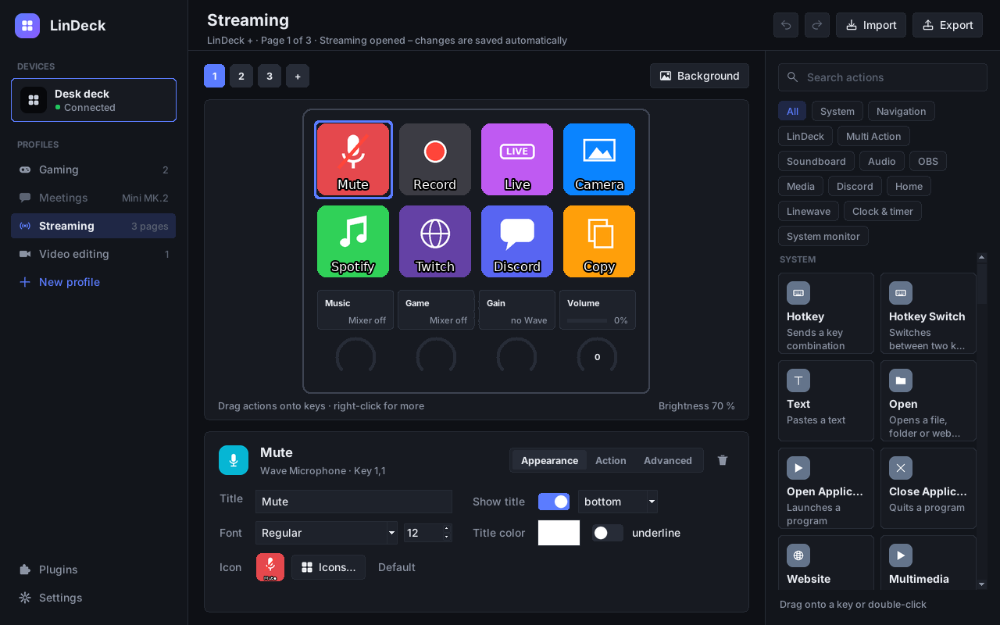
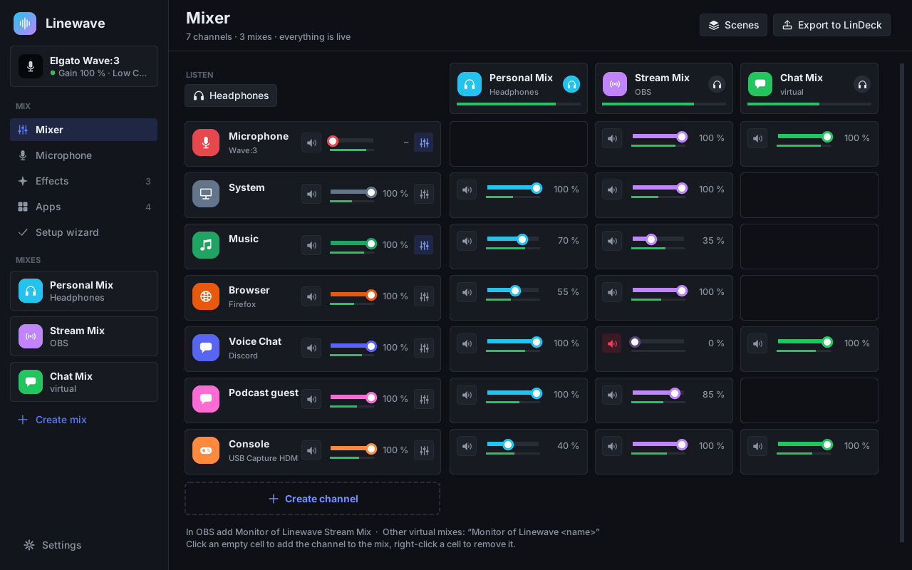
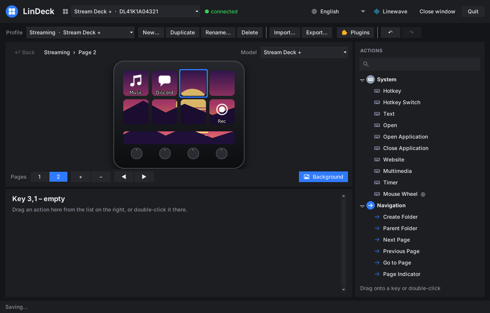
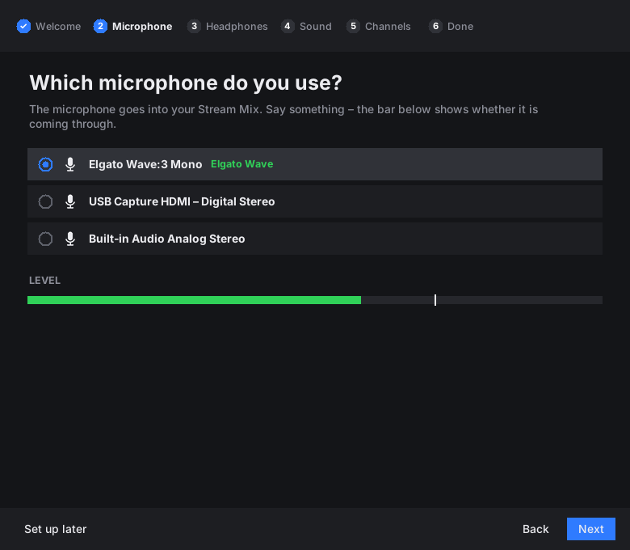
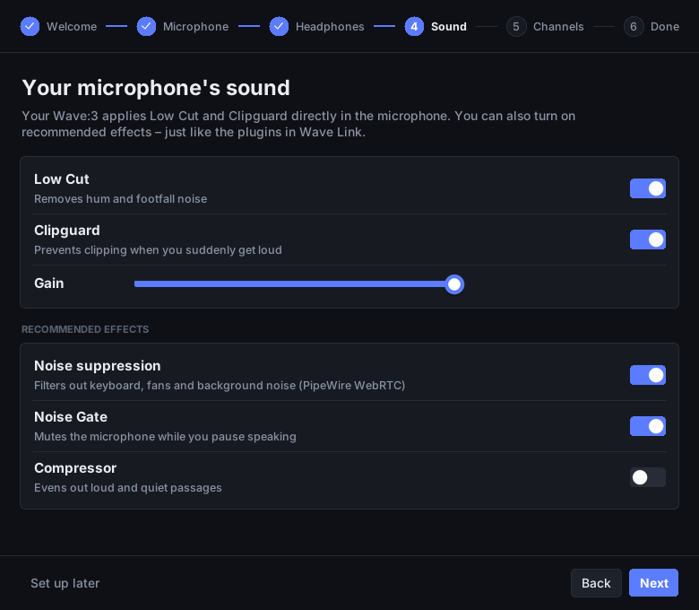
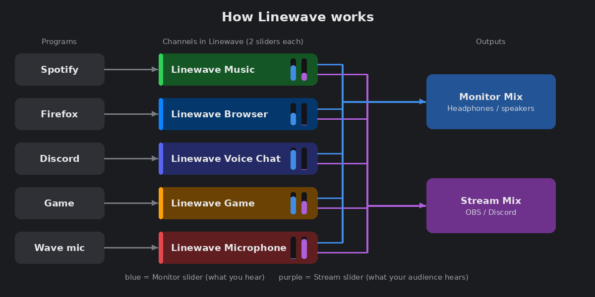
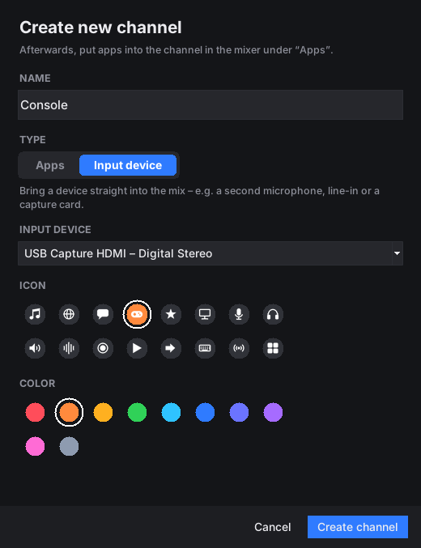
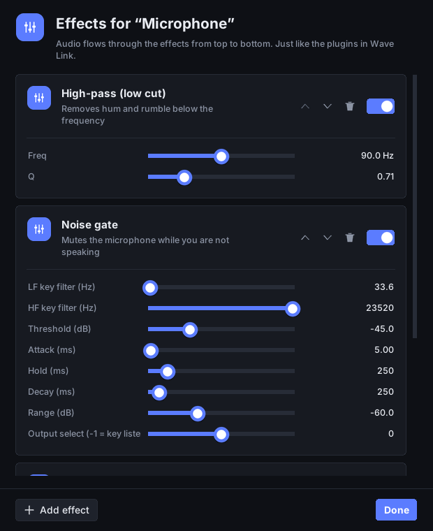
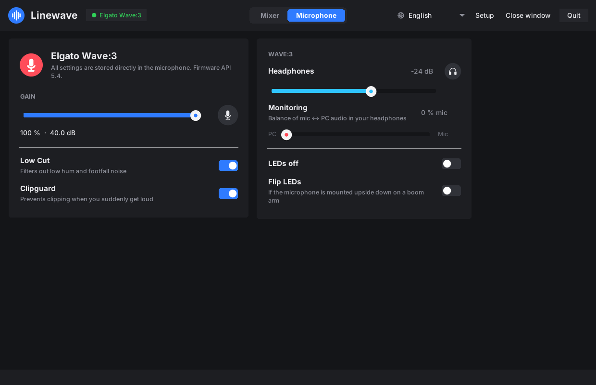

# Streamlin: Stream Deck and Wave Link for Linux

Streamlin brings the Elgato streaming setup to Linux. Its **LinDeck** program
runs every Elgato Stream Deck and reads the profiles of the
Elgato app **directly and unchanged**: keys, icons, folders, pages, multi
actions, dials and touch strips. Copy your profiles over, plug in the deck, done.
You can also edit profiles or create new ones right on Linux.

Streamlin contains **two programs**, just like Elgato's software:

| Program | Replaces | Purpose |
|---|---|---|
| **LinDeck** | Stream Deck app | keys, profiles, plugins |
| **Linewave** | Wave Link | audio mixer (Monitor Mix / Stream Mix), effects, Wave microphone |

| LinDeck | Linewave |
|---|---|
|  |  |

Both start invisibly when you log in. The menu entry opens the window; closing
the window keeps the program running in the background.

Available in **English, German, Spanish, French and Portuguese (Brazil)**.

## Get started

1. **Install:** download `streamlin_<version>_all.deb` from [Releases](../../releases)
   and double-click it, or run `sudo apt install ./streamlin_*_all.deb`.
   It replaces older `lindeck` packages; your profiles and settings stay.
2. **Bring your profiles:** on Windows, copy the folder
   `%APPDATA%\Elgato\StreamDeck\ProfilesV3` to a USB stick and plug it in on
   Linux. LinDeck imports everything by itself.
3. **Audio (optional):** open **Linewave** from the menu. A short setup wizard
   asks for your microphone, headphones and channels. In OBS, pick
   “Monitor of Linewave Stream Mix” as the audio source.

**Requirements:** a Debian-based distribution with Python ≥ 3.10 (Debian 12/13,
Ubuntu 22.04+, Linux Mint 21+, Pop!_OS, Zorin …), X11 or Wayland. The package
sets up device access, hotkeys, autostart and menu entries automatically. If
LinDeck does not start right after installing, log out and back in once.

**Uninstall:** `sudo apt remove streamlin` (your profiles stay in `~/.local/share/lindeck`).

> **Status:** version 0.13, tested with simulated devices of every model.
> Tests on real hardware are still pending; reports are welcome.

## Supported devices

| Device | Keys | Notes |
|---|---|---|
| Stream Deck Original / V2 / MK.2 / Module 15 | 15 | |
| Stream Deck Mini / Mini MK.2 / Module 6 | 6 | |
| Stream Deck XL / XL V2 / Module 32 | 32 | |
| Stream Deck Neo | 8 | infobar, 2 touch keys |
| Stream Deck + | 8 | 4 dials, touch strip |
| Stream Deck + XL | 36 | 6 dials, touch strip |
| Stream Deck Studio | 32 | 2 dials |
| Stream Deck Pedal | 3 pedals | |

Several devices at once and hot-plugging are supported.

## Importing profiles

Every 15 seconds LinDeck checks **Downloads**, **Desktop** and **USB sticks**
and imports on its own:

| Found | Result |
|---|---|
| `*.streamDeckProfile` | the profile is imported |
| `*.streamDeckProfilesBackup` | all profiles from the backup are imported |
| folder `ProfilesV2` / `ProfilesV3` (also zipped) | all profiles are imported |
| `Stream_Deck_*.msi` (Elgato installer) | the default Elgato icons are taken over |

Profiles from Stream Deck app 4.x to 7.x and from macOS work. A notification
appears after each import.

## The LinDeck window


Choose your Stream Deck at the top. The layout is the same as in the Elgato app:
the device in the middle, all actions on the right, the settings of the selected
key at the bottom.

| What | How |
|---|---|
| Assign an action | drag it from the list onto a key, or double-click it |
| Move or swap keys | drag a key; drop it on a page number to move it to another page |
| Copy, paste, delete | right-click, or `Ctrl+C`, `Ctrl+X`, `Ctrl+V`, `Del` |
| Title, font, color | in the **Appearance** section |
| Custom icon | **Choose image…** (PNG, JPG, SVG, animated GIF) |
| Record a hotkey | click into the hotkey field and press the keys |
| Folders, multi actions | double-click a folder to open it; add steps under **Included actions** |
| Pages | **+** / **−** add or remove pages, **◀ ▶** reorder them |
| Undo | `Ctrl+Z` / `Ctrl+Y` |
| Profiles | new, duplicate, rename, delete, import, export |

Changes are saved immediately and show up on the deck within a second or two.
Profiles stay in the Elgato format, so you can take them back to Windows with
**Export…**.

### Background images

**Background** below the device spreads a picture across all keys of a page,
with an option to darken it and to use it on every page. On the Stream Deck +
the touch strip can get its own image.

| | |
|---|---|
|  |  |

## Actions

All built-in actions of the Elgato app work:

| Action | On Linux |
|---|---|
| **Hotkey**, **Hotkey Switch** | virtual keyboard, works on X11 and Wayland |
| **Text** | pasted via the clipboard (emojis too) |
| **Multimedia** | media keys; on dials: system volume |
| **Open**, **Open Application**, **Close** | files, folders, URLs, programs; Windows programs are mapped to their Linux versions (Chrome, Firefox, Discord, Spotify, Steam, OBS, VS Code …) |
| **Website** | default or chosen browser |
| **Multi Action**, **Random Action**, **Delay** | as in the original |
| **Folders**, **Pages**, **Switch Profile** | incl. swiping on the touch strip |
| **Brightness**, **Sleep**, **Timer** | |
| **Soundboard** | play/stop audio with volume and loop |
| **Key Logic**, **Action Wheel**, **Dial Stack**, **Mouse Wheel** | |
| **Volume Controller** | input/output devices and app volume |
| **Smart Profiles** | switch profiles by active window (X11, KDE, Hyprland, Sway) |

## Plugins

**OBS, Spotify, Discord and Wave Link** are built in. Other Elgato plugins run in
the built-in plugin host: click **Plugins** → **Install plugin…** and choose the
`.streamDeckPlugin` file (or just drop it into Downloads).


- Plugins built with the official SDK (Node.js) work; install `nodejs` (version 20 recommended).
- Windows-only and macOS-only plugins cannot run; LinDeck shows this in the plugin list.
- **Settings page…** opens a plugin's settings like in the Elgato app.

### OBS

In OBS, enable *Tools → WebSocket Server Settings → Enable WebSocket server* and
put the password into `~/.config/lindeck/config.json`:
`"obs": {"password": "…"}`. Then `lindeck obs` checks the connection. Scenes,
recording, streaming, sources, audio, replay buffer and virtual camera are
supported, with live status on the keys.

### Spotify and other players

Works with every MPRIS player (Spotify, VLC, Firefox …): play/pause, next,
previous, shuffle, repeat, volume.

### Discord

Discord only allows this for registered apps, so set it up once:

1. Create an app at https://discord.com/developers/applications.
2. Under *OAuth2* add the redirect URL `http://localhost`.
3. Put the IDs into `config.json`: `"discord": {"client_id": "…", "client_secret": "…"}`
4. Run `lindeck discord` and confirm in Discord.

Then mute, deafen, push to talk and voice channels work from the deck.

## Linewave

Linewave replaces Elgato Wave Link. On first start, a wizard helps you choose
your microphone (with a level meter), your headphones (with a test tone), the
sound (Low Cut, Clipguard, gain, recommended effects) and your channels.
**Setup** at the top opens it again at any time.

| | |
|---|---|
|  |  |

### Mixer

Programs play into channels (System, Music, Browser, Voice Chat, Game, SFX,
Microphone). Every channel has **two sliders**:

- **Monitor Mix**: what you hear on your headphones
- **Stream Mix**: what your audience hears. In OBS, choose the audio source
  **“Monitor of Linewave Stream Mix”**.



Example: music loud in your headphones but quiet on stream → on “Music” turn
**Monitor** up and **Stream** down. Under **Apps** you choose which channel a
program plays into; Linewave remembers it. Well-known programs are sorted
automatically.

In the sound settings, `pavucontrol` and OBS the channels show up as
“Linewave Music”, “Linewave Game” and so on.

### Custom channels

**Add channel** creates a channel with a name, icon and color, either for
programs (e.g. “Podcast guest”) or for an **input device** such as a second
microphone, line-in or capture card. **•••** below a channel renames or deletes it.

<p align="center"></p>

### Effects

**FX** below a channel opens its effect chain, like the plugins in Wave Link.
Effects can be switched on and off, reordered and adjusted live.

| Effect | Package |
|---|---|
| High-pass (Low Cut), low-pass, bass, treble, EQ | built in |
| Noise suppression (RNNoise) | `noise-suppression-for-voice` |
| Noise gate, compressor, limiter | `swh-plugins` |
| Equalizer, de-esser, reverb | `tap-plugins` |
| Any LADSPA or **LV2** plugin, e.g. x42, LSP, Calf | `x42-plugins`, `lsp-plugins-lv2`, `calf-plugins` … |

For LV2 plugins on Ubuntu, also install `jalv` and `pipewire-jack` (recommended
by the package).



### Wave microphone



- **Wave:3:** gain, mute, Low Cut and Clipguard directly in the microphone,
  LEDs off or flipped, headphone volume and monitoring mix.
- **Wave:1, Wave Neo, Wave XLR:** gain and mute; Low Cut and Clipguard as
  filters. Pick **“Linewave Microphone”** as your microphone in Discord or OBS.

On the Stream Deck, the actions **Mixer Channel** and **Wave Microphone**
control all of this, even when the Linewave window is closed.

## Languages

LinDeck and Linewave follow your system language. To change it, click the
**globe button** at the top of either window. For a single start you can also
use `LINDECK_LANG=fr lindeck`.

**Help translate:** the texts are standard gettext files in
[`lindeck/locale/`](lindeck/locale/). Copy `lindeck.pot` to `<language>.po`
(e.g. `it.po`), fill it in with Poedit or any text editor, check it with
`python3 tools/i18n.py check <language>` and open a pull request.

## Commands

You don't need the terminal for normal use. Useful commands:

| Command | Purpose |
|---|---|
| `lindeck` / `linewave` | open the window |
| `lindeck quit` / `linewave --quit` | quit |
| `lindeck import <file or folder>` | import profiles manually |
| `lindeck devices` | list connected devices |
| `lindeck report` | which plugins and programs your profiles need |
| `lindeck plugin list` | installed plugins |
| `lindeck selftest --stop-daemon` | test every key, dial and the touch strip of your device |
| `linewave mixer` | mixer overview (`setup`, `remove`, `set music stream 40` …) |
| `linewave mic` | microphone status (`gain 70`, `mute`, `lowcut on` …) |

## Settings

Optional settings go into `~/.config/lindeck/config.json`, for example:

```json
{
  "language": "auto",
  "brightness": 70,
  "sleep_after_minutes": 0,
  "keyboard_layout": "auto",
  "app_map": { "obs64.exe": "flatpak run com.obsproject.Studio" },
  "path_map": { "C:/Users/Alex/Music": "/home/alex/Music" }
}
```

- `keyboard_layout`: the layout your profiles were made with on Windows (`de`, `us` or `auto`).
- `app_map`: which Linux command to start for a Windows program.
- `path_map`: replace Windows paths with Linux paths.

## Troubleshooting

| Problem | Solution |
|---|---|
| Device not detected | run `lindeck devices`; replug the device; log out and back in once after installing |
| Display shows “Profile missing” | there is no profile for this model yet: import one or create it in the window |
| Hotkeys don't work | log out and back in; check `ls -l /dev/uinput` |
| Wrong characters from hotkeys | set `keyboard_layout` to your Windows layout |
| A program doesn't start | `lindeck report` shows what's missing → add it to `app_map` |
| Key shows a warning symbol | the plugin is missing or Windows-only (`lindeck plugin list`) |
| No sound after setting up the mixer | choose your headphones at the top of the Linewave mixer; **Remove mixer** restores everything |

Log file: `~/.local/state/lindeck/lindeck.log`. Please attach it (and the
report from `lindeck selftest`) when you open an issue.

## Legal

Streamlin is an independent project and is not affiliated with Elgato or Corsair.
“Elgato”, “Stream Deck” and “Wave Link” are trademarks of Corsair Memory, Inc.
It contains no code and no graphics from Elgato; default icons are only
taken from your own Elgato installer. It bundles
[python-elgato-streamdeck](https://github.com/abcminiuser/python-elgato-streamdeck)
(MIT license).
