# FreeStream: Stream Deck and Wave Link for Linux

FreeStream brings the Elgato streaming setup to Linux with **two programs**:

| Program | Replaces | Purpose |
|---|---|---|
| **[FreeDeck](#freedeck)** | Stream Deck app | keys, profiles, plugins – reads your Elgato profiles **directly and unchanged** |
| **[FreeWave](#freewave)** | Wave Link | audio mixer with your own mixes (Personal, Stream, Chat …), effects, Wave microphone |

| FreeDeck | FreeWave |
|---|---|
| 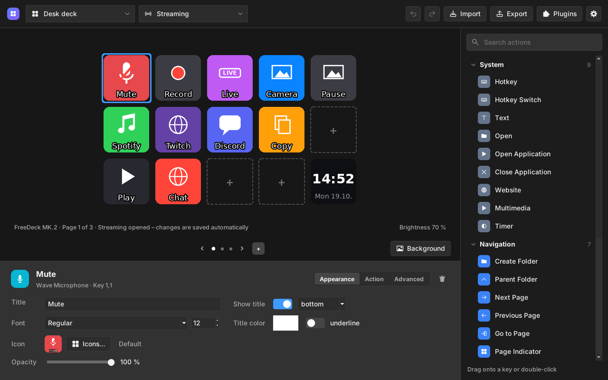 | 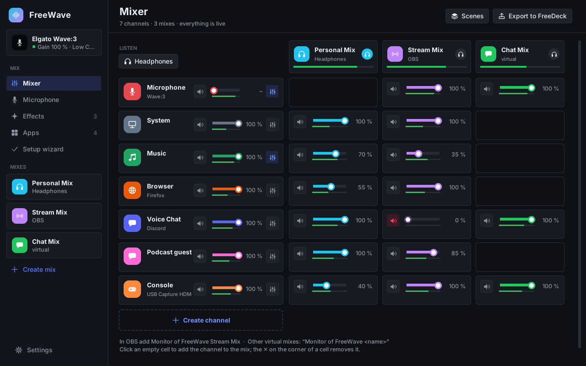 |

Available in **English, German, Spanish, French and Portuguese (Brazil)**.

> **New name:** FreeStream was called *Streamlin* until version 0.28 – FreeDeck was
> *LinDeck* and FreeWave was *Linewave*. Updating keeps all your profiles, mixes and
> settings; the old commands `lindeck` and `linewave` keep working.

**Contents**

- [Installation](#installation)
- [FreeDeck](#freedeck): [first start](#first-start) · [the window](#the-window) ·
  [icons and backgrounds](#icons-and-backgrounds) · [actions](#actions) ·
  [plugins and connections](#plugins-and-connections) · [settings](#freedeck-settings) ·
  [troubleshooting](#freedeck-troubleshooting)
- [FreeWave](#freewave): [first start](#first-start-1) · [the mixer](#the-mixer) ·
  [apps and channels](#apps-and-channels) · [more features](#more-features) ·
  [FreeWave on the deck](#freewave-on-the-deck) · [troubleshooting](#freewave-troubleshooting)
- [For both programs](#for-both-programs): settings file, help, legal

## Installation

1. Download from [Releases](../../releases) and double-click it, or run
   `sudo apt install ./<file>.deb`:
   - `freestream_<version>_all.deb` – both programs (recommended)
   - `freedeck_<version>_all.deb` – only FreeDeck
   - `freewave_<version>_all.deb` – only FreeWave

   You can install FreeDeck and FreeWave separately and add the other one later.
2. Start **FreeDeck** or **FreeWave** from the menu. Both also start invisibly when
   you log in; closing a window keeps the program running in the background.

**Requirements:** a Debian-based distribution (Debian 12/13, Ubuntu 22.04+,
Linux Mint 21+, Pop!_OS, Zorin …) with Python ≥ 3.10, X11 or Wayland. The package
sets up device access, hotkeys, autostart and menu entries. If FreeDeck does not
start right after installing, log out and back in once.

**Updates:** at every start, FreeDeck and FreeWave look for a new release and
install it after you confirm (can be switched off in **Settings**).
**Uninstall:** `sudo apt remove freestream` (or `freedeck` / `freewave`); your
profiles stay in `~/.local/share/freestream`.

> **Status:** version 0.28, tested with simulated devices of every model.
> Tests on real hardware are still pending; reports are welcome.

---

# FreeDeck

FreeDeck runs every Elgato Stream Deck – keys, icons, folders, pages, multi
actions, dials and touch strips – with your profiles from the Elgato app. You can
also edit profiles or create new ones right on Linux.

## First start

On Windows, copy the folder `%APPDATA%\Elgato\StreamDeck\ProfilesV3` to a USB
stick and plug it in on Linux. At the first start, the **setup** finds your deck
and takes over the profiles from the stick, your Downloads folder or files you
choose – or starts you off with an empty profile.

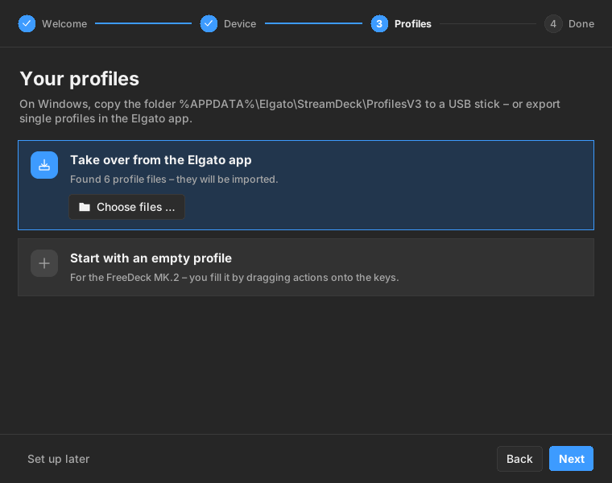

Later, FreeDeck still imports new profiles (`.streamDeckProfile` files and
backups) from USB sticks and Downloads by itself.

## The window

Like in the Elgato app: the device in the middle, all actions on the right, the
settings of the selected key at the bottom.

- **Drag an action onto a key** (or double-click it), drag keys to move them,
  right-click for copy, paste and delete. Changes show up on the deck right away.
- It also works the other way round: turn the page, open a folder or switch the
  profile on the deck and the window follows; keys that change by themselves
  (volume, mute, clock …) look exactly like on the deck.
- The device is drawn like your model: touch strip and dials on the Stream Deck +,
  the info bar on the Neo (‹ › turn the pages), pedals on the Pedal. Free keys are
  dashed with a “+”.
- **Profiles:** **New profile** only asks for a name – FreeDeck knows the connected
  model. Right-click a profile to rename, duplicate, export or delete it. Profiles
  stay in the Elgato format, so **Export…** takes them back to Windows.
- **On the deck**, a key briefly shows **Done** or **Error** after its action; a
  Multi Action shows **Step 2 / 5** with a progress bar.

## Icons and backgrounds

**Icons …** next to the key preview opens the **icon library**: over 100 icons
drawn for FreeDeck in three packs (**Color**, **White**, **Black**) with search and
zoom. **Own image …** takes any picture.

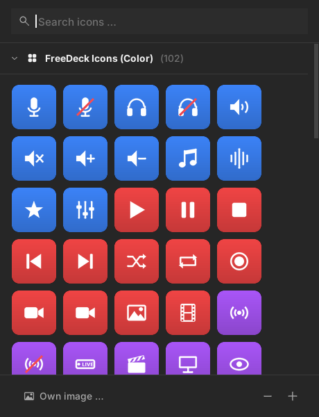

**Background** above the device spreads a picture across all keys of a page; the
touch strip of the Stream Deck + can get its own image.

| | |
|---|---|
| 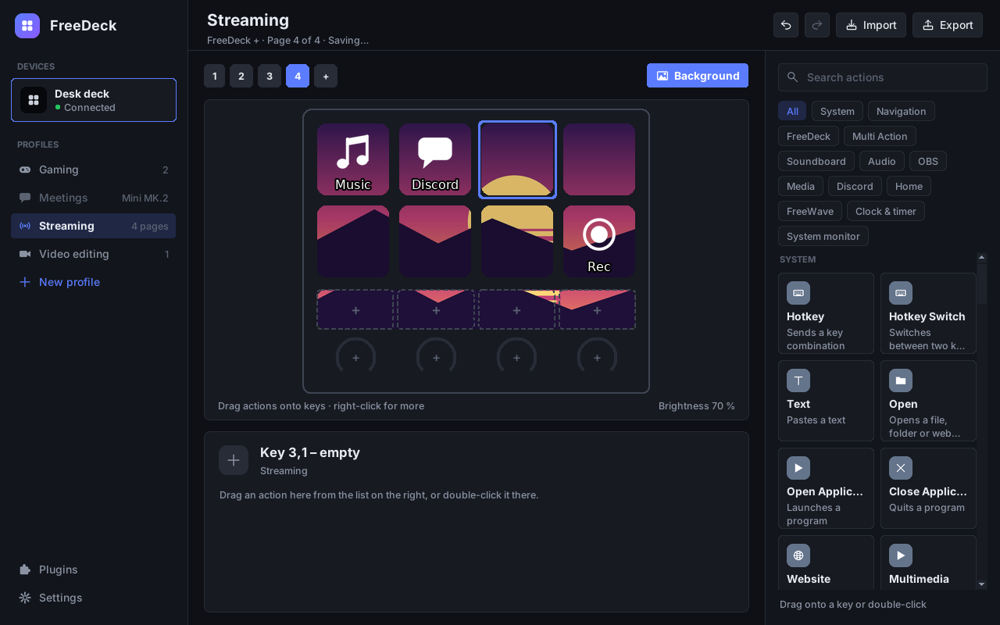 | 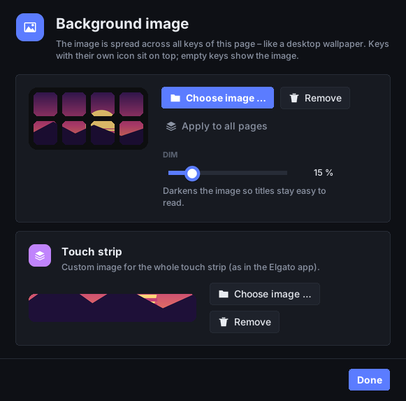 |

## Actions

All built-in actions of the Elgato app work:

| Action | On Linux |
|---|---|
| **Hotkey**, **Hotkey Switch** | virtual keyboard, works on X11 and Wayland |
| **Text** | pasted via the clipboard (emojis too) |
| **Multimedia** | media keys; on dials: system volume |
| **Open**, **Open Application**, **Close** | files, folders, URLs, programs; Windows programs are mapped to their Linux versions |
| **Website** | default or chosen browser |
| **Multi Action**, **Random Action**, **Delay** | as in the original |
| **Folders**, **Pages**, **Switch Profile** | incl. swiping on the touch strip |
| **Brightness**, **Sleep**, **Timer** | |
| **Soundboard** | play/stop audio with volume and loop |
| **Key Logic**, **Action Wheel**, **Dial Stack**, **Mouse Wheel** | |
| **Volume Controller** | input/output devices and app volume |
| **Smart Profiles** | switch profiles by active window (X11, KDE, Hyprland, Sway) – see **Settings → Profiles** |

FreeDeck adds its own **live keys**: **Clock**, **Countdown** (flashes and plays a
sound at zero), **Stopwatch** and a **system monitor** (CPU, memory, temperature,
network, battery, disk space).

## Plugins and connections

**OBS, Spotify, Discord, Home Assistant and Wave Link** are built in. Other Elgato
plugins: **Settings → Plugins → Install plugin …** and choose the
`.streamDeckPlugin` file. There you also see whether it runs, its log, and can
restart or remove it. Plugins built with the official SDK need
[Node.js](https://nodejs.org/en/download) (version 20 recommended); Windows-only
and macOS-only plugins cannot run.

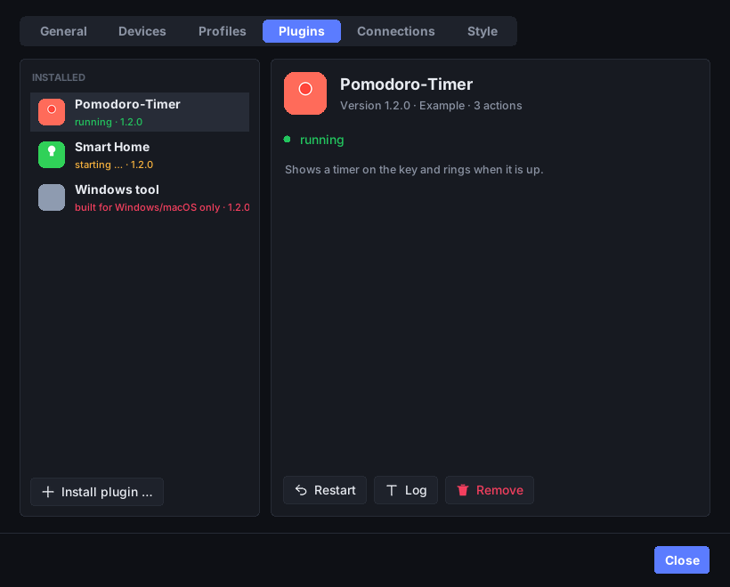

The services are set up under **Settings → Connections**, each with a
connection test:

| Service | What to do |
|---|---|
| **OBS** | turn on the WebSocket server ([OBS guide](https://obsproject.com/kb/remote-control-guide)) and enter its password |
| **Discord** | create an app in the [Discord Developer Portal](https://discord.com/developers/applications) with the redirect URL `http://localhost`, enter its Client ID and Client Secret and click **Connect …** |
| **Home Assistant** | enter your address and a [long-lived access token](https://www.home-assistant.io/docs/authentication/#your-account-profile) |
| **Spotify and other players** | nothing to do – every MPRIS player works |

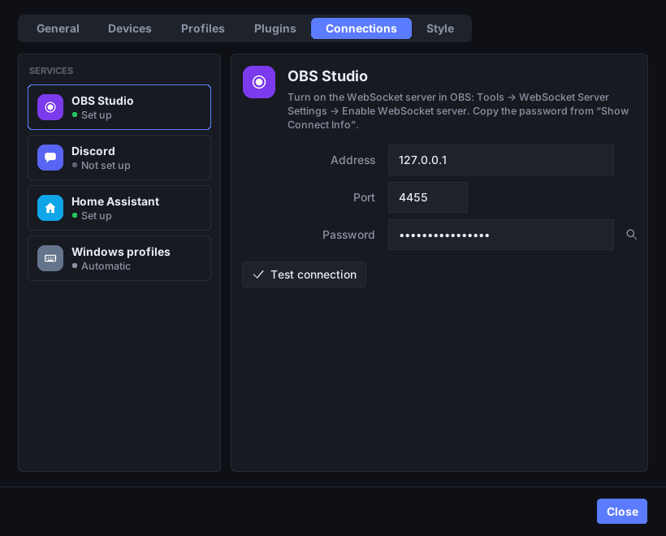

<a id="freedeck-settings"></a>
## Settings

**Settings** (gear at the bottom of the sidebar) have tabs, like the Elgato app:

| Tab | |
|---|---|
| **General** | version and updates, start when you log in, light/dark, language, help and backup |
| **Devices** | per deck: name, on/off, **orientation** (upside down 180°), **sleep after**, brightness, serial number, firmware, profile |
| **Profiles** | switch profiles **automatically** by the program in the foreground, and the **default profile** |
| **Plugins** | installed plugins with status, log, restart and remove |
| **Connections** | OBS, Discord, Home Assistant – and **Windows profiles**: keyboard layout and which Linux program or folder replaces a Windows one |
| **Style** | progress of a **Multi Action** on the key, and a **font for all keys** – **Apply to all keys** changes every profile |

| | |
|---|---|
| 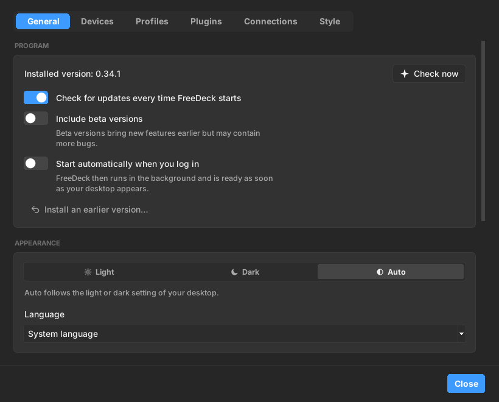 | 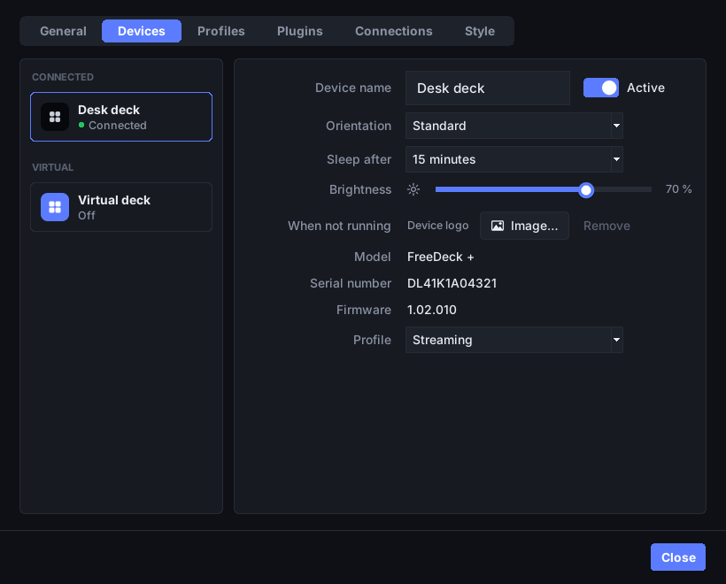 |
| 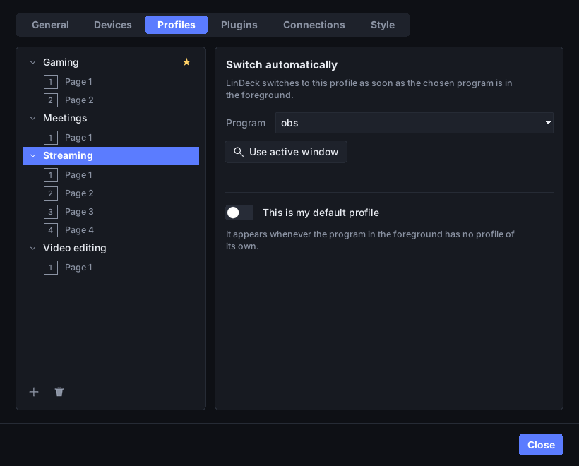 | 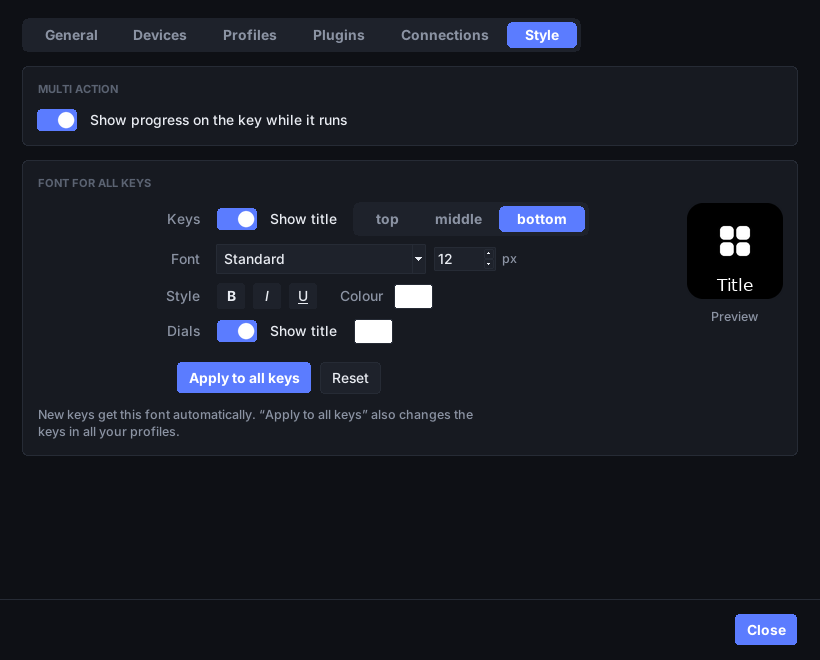 |

<a id="freedeck-troubleshooting"></a>
## Troubleshooting

| Problem | Solution |
|---|---|
| Device not detected | replug the device; log out and back in once after installing |
| A key shows “No profile – choose in FreeDeck” | there is no profile for this model yet: import one or create it in the window |
| Hotkeys don't work | log out and back in; check `ls -l /dev/uinput` |
| Wrong characters from hotkeys | **Settings → Connections → Windows profiles**: choose your Windows keyboard layout |
| A program doesn't start | `freedeck report` shows what's missing → add it under **Settings → Connections → Windows profiles** |
| Key shows a warning symbol | the plugin is missing or Windows-only |

---

# FreeWave

FreeWave replaces Elgato Wave Link: an audio mixer for PipeWire with your own
mixes, effects and support for Elgato Wave microphones.

## First start

A short wizard asks for your microphone, your headphones, the sound and your
channels. **Setup wizard** in the window opens it again at any time.

## The mixer

Programs play into **channels** (System, Music, Browser, Voice Chat, Game, SFX,
Microphone). The mixer is a table like **Mixes** in Wave Link: one row per
channel with a **master slider**, one column per **mix** with its own slider and
mute for every channel.

- **Personal Mix** – what you hear on your headphones (also on several devices at once).
- **Stream Mix** – what your audience hears. In OBS, choose the audio source
  **“Monitor of FreeWave Stream Mix”**.
- **Your own mixes** – **Create mix** in the sidebar, e.g. a **Chat Mix** for
  Discord (choose “Monitor of FreeWave Chat Mix” as microphone there). A mix goes
  to any devices you tick and/or to a virtual source for other programs.

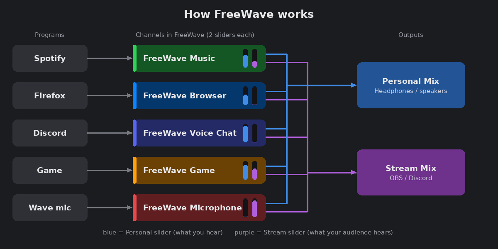

- **Click an empty cell** (it shows ⊕) to put a channel into a mix; the small ✕
  on a cell takes it out. New mixes and channels start empty.
- **Right-click a mix** to edit, listen to or delete it. The headphones button in
  a mix header lets you **listen** to that mix for a moment.

## Apps and channels

Under **Apps** you choose which channel a program plays into; new programs go into
the matching channel by themselves. **Add channel** creates your own channels,
also for an input device such as a second microphone or a capture card.

## More features

| Feature | |
|---|---|
| **Effects** | **FX** below a channel: high-pass, EQ, gate, compressor, reverb and any LADSPA/LV2 plugin (`swh-plugins`, `tap-plugins`, `x42-plugins` …) |
| **Scenes** | save the whole mix under a name and switch with one click, a shortcut or a deck key |
| **Auto-ducking** | music gets quieter while you speak and comes back afterwards |
| **Noise suppression** | for any microphone; uses [RNNoise](https://github.com/werman/noise-suppression-for-voice) if installed, otherwise PipeWire's built-in filter |
| **Keyboard shortcuts** | mute the microphone or apply a scene from any app, also on Wayland |
| **Wave microphones** | Wave:3: gain, mute, Low Cut, Clipguard, LEDs and monitoring; Wave:1, Neo, XLR: gain and mute |

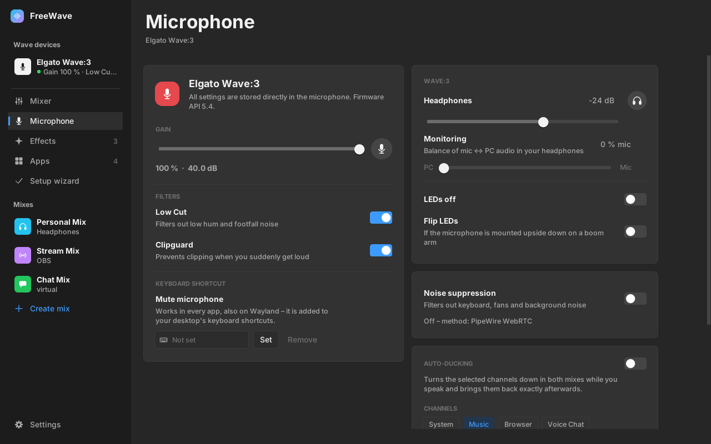

## FreeWave on the deck

With FreeDeck installed too, **Export to FreeDeck** in the mixer header creates a
profile “FreeWave” for your deck – laid out like the Wave Link profile – and keeps
it up to date when you add or delete channels. Only channels you actually use are
pre-selected (something plays in them, a program is assigned, microphone and inputs);
a channel you start using later is added by itself:

- top row: mix keys (All and every mix) and “Channels 1–7”
- per channel: a tile with icon and volume (press = mute) and a fader over two
  keys (upper = louder, lower = quieter – hold the key to keep going)
- on the Stream Deck +: the dials

The actions **Mixer Channel**, **Mixer Scene** and **Wave Microphone** work even
when the FreeWave window is closed.

<a id="freewave-troubleshooting"></a>
## Troubleshooting

| Problem | Solution |
|---|---|
| No sound after setting up the mixer | choose your headphones under **Listen** in the mixer; **Settings → Remove mixer** restores everything |
| OBS hears nothing | use the audio source “Monitor of FreeWave Stream Mix” and check that the channel is in the Stream Mix |

FreeWave's **Settings** have the general part plus **Remove mixer / Set up mixer**.

---

# For both programs

**Settings file:** everything is stored in `~/.config/freestream/config.json`.
Passwords and access tokens (OBS, Discord, Home Assistant) go into your desktop's
**keyring** (GNOME Keyring, KWallet); without a keyring they stay in the file,
which then only you can read. The Windows-profile values look like this:

```json
{
  "keyboard_layout": "auto",
  "app_map": { "obs64.exe": "flatpak run com.obsproject.Studio" },
  "path_map": { "C:/Users/Alex/Music": "/home/alex/Music" }
}
```

**Help:** **Settings → Help → Create support report…** and attach the file to a
[GitHub issue](../../issues/new).

**Legal:** FreeStream is an independent project and is not affiliated with Elgato
or Corsair. “Elgato”, “Stream Deck” and “Wave Link” are trademarks of Corsair
Memory, Inc. It contains no code and no graphics from Elgato; default icons are
only taken from your own Elgato installer. It bundles
[python-elgato-streamdeck](https://github.com/abcminiuser/python-elgato-streamdeck)
(MIT license).
