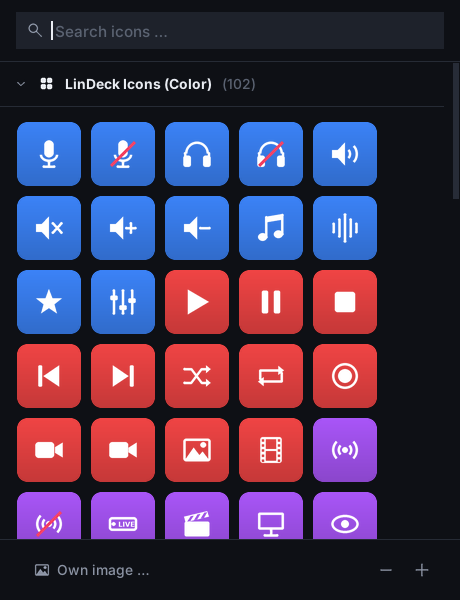

# Streamlin: Stream Deck and Wave Link for Linux

Streamlin brings the Elgato streaming setup to Linux. Its **LinDeck** program
runs every Elgato Stream Deck and reads the profiles of the
Elgato app **directly and unchanged**: keys, icons, folders, pages, multi
actions, dials and touch strips. Copy your profiles over, plug in the deck, done.
You can also edit profiles or create new ones right on Linux.

Streamlin contains **two programs**, just like Elgato's software:

| Program | Replaces | Purpose |
|---|---|---|
| **LinDeck** | Stream Deck app | keys, profiles, plugins |
| **Linewave** | Wave Link | audio mixer with your own mixes (Personal, Stream, Chat …), effects, Wave microphone |

| LinDeck | Linewave |
|---|---|
|  |  |

Both start invisibly when you log in. The menu entry opens the window; closing
the window keeps the program running in the background. Language, light/dark
mode, updates, autostart, backups and the support report are under **Settings**
(gear) at the bottom of the sidebar – in LinDeck together with your devices,
profiles, plugins and the key style (see [Settings](#settings)).

Available in **English, German, Spanish, French and Portuguese (Brazil)**.

## Get started

1. **Install:** download from [Releases](../../releases) and double-click it, or
   run `sudo apt install ./<file>.deb`:
   - `streamlin_<version>_all.deb` – both programs (recommended)
   - `lindeck_<version>_all.deb` – only LinDeck (Stream Deck)
   - `linewave_<version>_all.deb` – only Linewave (mixer and Wave microphone)

   You can install LinDeck and Linewave separately and add the other one later;
   together they work exactly like `streamlin`.
2. **Bring your profiles:** on Windows, copy the folder
   `%APPDATA%\Elgato\StreamDeck\ProfilesV3` to a USB stick and plug it in on
   Linux. LinDeck imports everything by itself (also `.streamDeckProfile` files
   and backups from your Downloads folder).
3. **Audio (optional):** open **Linewave** from the menu. A short setup wizard
   asks for your microphone, headphones and channels. In OBS, pick
   “Monitor of Linewave Stream Mix” as the audio source.

**Requirements:** a Debian-based distribution (Debian 12/13, Ubuntu 22.04+,
Linux Mint 21+, Pop!_OS, Zorin …) with Python ≥ 3.10, X11 or Wayland. The package sets up device access, hotkeys, autostart and menu
entries. If LinDeck does not start right after installing, log out and back in
once.

**Updates:** at every start, LinDeck and Linewave look for a new release and
install it after you confirm. You can switch this off in **Settings**.

**Uninstall:** `sudo apt remove streamlin` (or `lindeck` / `linewave`); your
profiles stay in `~/.local/share/streamlin`.

> **Status:** version 0.27, tested with simulated devices of every model.
> Tests on real hardware are still pending; reports are welcome.

## The LinDeck window

The layout is the same as in the Elgato app: the device in the middle, all
actions on the right, the settings of the selected key at the bottom. The device
is drawn like your model – touch strip and dials on the Stream Deck +, the info
bar on the Neo, pedals on the Pedal; free keys are dashed with a “+”. Drag an
action onto a key (or double-click it), drag keys to move them, right-click for
copy, paste and delete. Changes show up on the deck right away. Profiles stay in
the Elgato format, so you can take them back to Windows with **Export…**.

LinDeck recognises the connected Stream Deck by itself: **New profile** only asks
for a name, and profiles for a model that is not plugged in are shown greyed out.
Right-click a profile to open, rename, duplicate, export or delete it.

On the deck itself, a key briefly shows **Done** or **Error** after its action,
and a Multi Action shows **Step 2 / 5** with a progress bar while it runs.

**Icons …** next to the key preview (or a click on the preview) opens the **icon
library**: over 100 icons drawn for LinDeck in three packs – **Color**, **White**
and **Black** – with a search field and zoom. **Own image …** takes any picture.



**Background** below the device spreads a picture across all keys of a page; on
the Stream Deck + the touch strip can get its own image.

| | |
|---|---|
|  |  |

## Actions

All built-in actions of the Elgato app work:

| Action | On Linux |
|---|---|
| **Hotkey**, **Hotkey Switch** | virtual keyboard, works on X11 and Wayland |
| **Text** | pasted via the clipboard (emojis too) |
| **Multimedia** | media keys; on dials: system volume |
| **Open**, **Open Application**, **Close** | files, folders, URLs, programs; Windows programs are mapped to their Linux versions |
| **Website** | default or chosen browser |
| **Multi Action**, **Random Action**, **Delay** | as in the original |
| **Folders**, **Pages**, **Switch Profile** | incl. swiping on the touch strip |
| **Brightness**, **Sleep**, **Timer** | |
| **Soundboard** | play/stop audio with volume and loop |
| **Key Logic**, **Action Wheel**, **Dial Stack**, **Mouse Wheel** | |
| **Volume Controller** | input/output devices and app volume |
| **Smart Profiles** | switch profiles by active window (X11, KDE, Hyprland, Sway) – set up under **Settings → Profiles** |

LinDeck adds its own **live keys**: **Clock**, **Countdown** (flashes and plays a
sound at zero), **Stopwatch** and a **system monitor** (CPU, memory,
temperature, network, battery, disk space).

## Plugins

**OBS, Spotify, Discord, Home Assistant and Wave Link** are built in. Other
Elgato plugins run in the built-in plugin host: open **Settings → Plugins** (or
**Plugins** in the sidebar) → **Install plugin …** and choose the
`.streamDeckPlugin` file. On the right you see whether it runs, its log, and you
can restart or remove it.


Plugins built with the official SDK need [Node.js](https://nodejs.org/en/download)
(version 20 recommended). Windows-only and macOS-only plugins cannot run.

| Integration | Setup |
|---|---|
| **OBS** | turn on the WebSocket server ([OBS guide](https://obsproject.com/kb/remote-control-guide)) and put its password into the settings file: `"obs": {"password": "…"}` |
| **Spotify and other players** | nothing to do – every MPRIS player works |
| **Discord** | create an app in the [Discord Developer Portal](https://discord.com/developers/applications) with the redirect URL `http://localhost`, put `"discord": {"client_id": "…", "client_secret": "…"}` into the settings file and run `lindeck discord` |
| **Home Assistant** | select a Home Assistant action, click **Connect …** and enter your address and a [long-lived access token](https://www.home-assistant.io/docs/authentication/#your-account-profile) |

## Linewave

Linewave replaces Elgato Wave Link. On first start, a wizard helps you choose
your microphone, your headphones, the sound and your channels; **Setup wizard**
opens it again at any time.

Programs play into channels (System, Music, Browser, Voice Chat, Game, SFX,
Microphone). The mixer is a table like **Mixes** in Wave Link: one row per
channel with a **master slider**, one column per **mix** with its own slider
and mute for every channel:

- **Personal Mix**: what you hear on your headphones (also on several devices at once)
- **Stream Mix**: what your audience hears. In OBS, choose the audio source
  **“Monitor of Linewave Stream Mix”**.
- **Your own mixes**: **Create mix** below the mixes in the sidebar, e.g. a **Chat Mix** for Discord (choose
  “Monitor of Linewave Chat Mix” as microphone there). A mix goes to any devices
  you tick and/or to a virtual source for other programs.

Click an empty cell (it shows ⊕ when you point at it) to put a channel into a mix;
the small ✕ on the corner of a cell takes it out. New mixes and new channels start
empty – you decide what goes where.
Right-click a mix (in the sidebar or its column header) to edit, listen to or delete it.
The headphones button in a mix header lets you **listen** to that mix on your
headphones for a moment.


Under **Apps** you choose which channel a program plays into. **Add channel**
creates your own channels, also for an input device such as a second microphone
or a capture card.

| Feature | |
|---|---|
| **Effects** | **FX** below a channel: high-pass, EQ, gate, compressor, reverb and any LADSPA/LV2 plugin (`swh-plugins`, `tap-plugins`, `x42-plugins` …) |
| **Channels on LinDeck** | **Export to LinDeck** in the Mixer header creates a LinDeck profile “Linewave” for the connected Stream Deck (detected by itself; a deck plugged in later gets its own profile automatically) – laid out like the Wave Link profile – and keeps it up to date when you add or delete channels: mix keys (All and every mix) and “Channels 1–7” on top, per channel a tile with its icon and volume (press = mute) and a fader over two keys (upper key = louder, lower key = quieter); dials on the Stream Deck + |
| **Scenes** | save the whole mix under a name and switch with one click, a shortcut or the Stream Deck key **Mixer Scene** |
| **Auto-ducking** | music gets quieter while you speak and comes back exactly afterwards |
| **Noise suppression** | for any microphone; uses [RNNoise](https://github.com/werman/noise-suppression-for-voice) if installed, otherwise PipeWire's built-in filter |
| **Keyboard shortcuts** | mute the microphone or apply a scene from any app, also on Wayland (GNOME, Cinnamon, MATE, XFCE, KDE) |
| **Wave microphones** | Wave:3: gain, mute, Low Cut, Clipguard, LEDs and monitoring directly in the microphone; Wave:1, Neo, XLR: gain and mute |


On the Stream Deck, the actions **Mixer Channel**, **Mixer Scene** and **Wave
Microphone** control all of this, even when the Linewave window is closed.

## Settings

LinDeck's **Settings** have tabs, like the Elgato app:

| Tab | |
|---|---|
| **General** | version and updates, start automatically when you log in, light/dark, language, help and backup |
| **Devices** | per connected deck: name, on/off, **orientation** (upside down 180°), **sleep after** (never … 60 min), brightness, serial number, firmware and the profile it uses |
| **Profiles** | switch to a profile **automatically** when a program is in the foreground (pick it from the list or take the active window) and choose your **default profile** |
| **Plugins** | installed plugins with status, log, restart and remove |
| **Style** | progress of a **Multi Action** on the key, and a **font for all keys** (title on/off, position, font, size, bold/italic/underline, colour) – new keys get it, **Apply to all keys** changes every profile |

| | |
|---|---|
|  |  |
|  |  |

Linewave's settings have the general part plus **Remove mixer / Set up mixer**.

### Settings file

Everything above is stored in `~/.config/streamlin/config.json`. A few options
exist only there, for example:

```json
{
  "keyboard_layout": "auto",
  "app_map": { "obs64.exe": "flatpak run com.obsproject.Studio" },
  "path_map": { "C:/Users/Alex/Music": "/home/alex/Music" }
}
```

- `keyboard_layout`: the layout your profiles were made with on Windows (`de`, `us` or `auto`).
- `app_map`: which Linux command to start for a Windows program.
- `path_map`: replace Windows paths with Linux paths.

## Troubleshooting

| Problem | Solution |
|---|---|
| Device not detected | replug the device; log out and back in once after installing |
| A key shows “No profile – choose in LinDeck” | there is no profile for this model yet: import one or create it in the window |
| Hotkeys don't work | log out and back in; check `ls -l /dev/uinput` |
| Wrong characters from hotkeys | set `keyboard_layout` to your Windows layout |
| A program doesn't start | `lindeck report` shows what's missing → add it to `app_map` |
| Key shows a warning symbol | the plugin is missing or Windows-only |
| No sound after setting up the mixer | choose your headphones under **Listen** in the mixer; **Settings → Remove mixer** restores everything |

Still stuck? **Settings → Help → Create support report…** and attach the file to
a [GitHub issue](https://github.com/adblocker-1/Streamlin/issues/new).

## Legal

Streamlin is an independent project and is not affiliated with Elgato or Corsair.
“Elgato”, “Stream Deck” and “Wave Link” are trademarks of Corsair Memory, Inc.
It contains no code and no graphics from Elgato; default icons are only
taken from your own Elgato installer. It bundles
[python-elgato-streamdeck](https://github.com/abcminiuser/python-elgato-streamdeck)
(MIT license).
