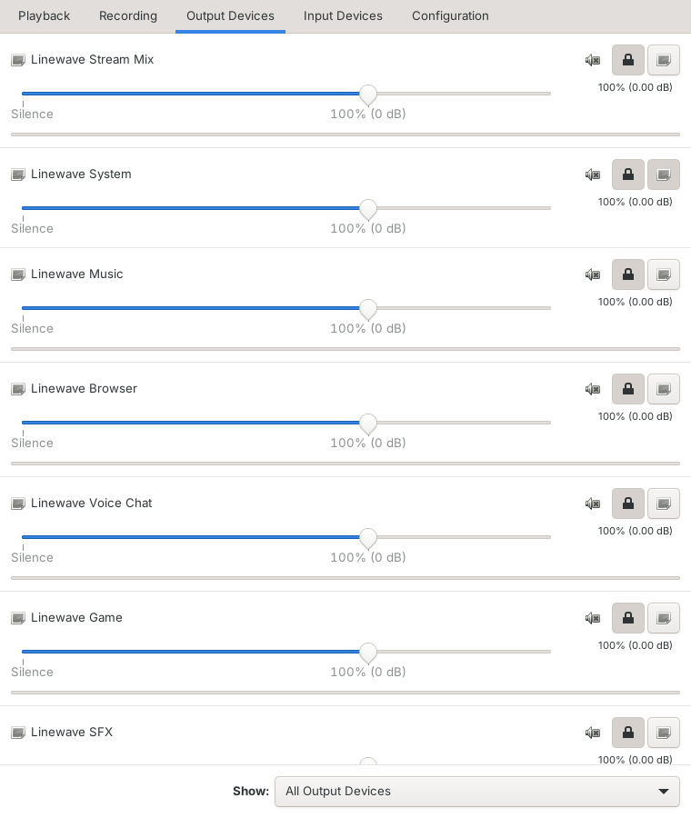
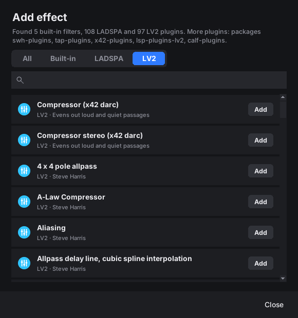

# Elgato Stream Deck for Linux (LinDeck)

**English** · [Deutsch](README.de.md)

A Linux replacement for the Elgato Stream Deck software. LinDeck drives every
Stream Deck model over USB and reads the profiles of the Elgato app **directly
and unchanged**: keys, icons, titles, folders, pages, multi actions, dials and
touch strips. There is no need to set anything up again on Linux, and the
LinDeck window lets you edit existing profiles or create new ones right on Linux.

**Two programs, just like Elgato:**

| Program | Elgato counterpart | Purpose |
|---|---|---|
| **LinDeck** (`lindeck`) | Stream Deck | Keys, profiles, plugins |
| **Linewave** (`linewave`) | Wave Link | Audio mixer (Monitor Mix / Stream Mix) and Wave microphone |

| LinDeck: set up keys and profiles | Linewave: mixer for headphones and stream |
|---|---|
|  |  |

Both start invisibly when you log in and work in the background. The menu
entry of each program opens its window; closing the window keeps the program
running.

LinDeck and Linewave are available in **English, German, Spanish, French and
Portuguese (Brazil)**. They follow your system language; see
[Languages](#languages) to change it or to add a translation.

### Get started in 3 steps

1. **Install:** download `lindeck_<version>_all.deb` from [Releases](../../releases)
   and double-click it (details under [Installation](#installation)).
2. **Stream Deck:** copy the Windows folder `ProfilesV3` to a USB stick and
   plug it in. LinDeck imports all profiles by itself. You can change them in
   the **LinDeck** window (application menu).
3. **Audio (optional):** open **Linewave** from the menu. The setup wizard asks
   for your microphone, headphones and channels. Then pick
   “Monitor of Linewave Stream Mix” as the audio source in OBS. Done.

You install a single `.deb` file. Everything else happens automatically:
device access, virtual keyboard, autostart and importing your profiles.

> **Status:** version 0.12, tested with simulated devices of every model and
> the Elgato default profiles. Tests on real hardware are still pending.

---

## Contents

- [Supported devices](#supported-devices)
- [Installation](#installation)
- [Importing profiles](#importing-profiles)
- [The LinDeck window](#the-lindeck-window)
- [Linewave](#linewave)
- [Supported actions](#supported-actions)
- [Elgato plugins](#elgato-plugins)
- [OBS, Spotify, Discord](#obs-spotify-discord)
- [Audio mixer (Wave Link replacement)](#audio-mixer-wave-link-replacement)
- [Wave microphone](#wave-microphone)
- [Hardware self-test](#hardware-self-test)
- [Commands](#commands)
- [Configuration](#configuration)
- [Languages](#languages)
- [Troubleshooting](#troubleshooting)
- [Development](#development)
- [Project layout](#project-layout)
- [Roadmap](#roadmap)
- [Legal](#legal)

---

## Supported devices

| Device | Keys | Notes |
|---|---|---|
| Stream Deck Original / V2 / MK.2 (incl. Scissor Keys, Module 15) | 15 | |
| Stream Deck Mini / Mini MK.2 (incl. Discord Edition, Module 6) | 6 | |
| Stream Deck XL / XL V2 (incl. Module 32) | 32 | |
| Stream Deck Neo | 8 | Infobar (clock, page indicator), 2 touch keys for paging |
| Stream Deck + | 8 | 4 dials, touch strip (tap, hold, swipe) |
| Stream Deck + XL | 36 | 6 dials, touch strip |
| Stream Deck Studio | 32 | 2 dials |
| Stream Deck Pedal | 3 pedals | |

Several devices at once and plugging/unplugging while running are supported.
Profiles are matched to the right device automatically (model code, otherwise
key layout).

## Installation

**Requirements:** a Debian-based distribution with Python ≥ 3.10
(Debian 12/13, Ubuntu 22.04+, Linux Mint 21+, Pop!_OS, Zorin …), X11 or Wayland.

1. Download the current `lindeck_<version>_all.deb` from
   [Releases](../../releases).
2. Double-click → **Install**, or in a terminal:

   ```bash
   sudo apt install ./lindeck_0.12.0_all.deb
   ```

The package takes care of:

- all dependencies via `apt` (the Stream Deck library is bundled)
- a udev rule for device access without root (`/lib/udev/rules.d/70-lindeck.rules`)
- the `uinput` module for hotkeys on X11 **and** Wayland
- autostart at every login and an immediate start after installation
- menu entries “LinDeck” and “Linewave” with their own icons

If LinDeck does not start right after installation, log out and back in once.

**Uninstall:** `sudo apt remove lindeck`. Your profiles in
`~/.local/share/lindeck` are kept.

## Importing profiles

### Automatically (recommended)

Every 15 seconds LinDeck looks through **Downloads**, **Desktop** and
**plugged-in USB sticks** and imports on its own:

| Found | Action |
|---|---|
| `*.streamDeckProfile` | the profile is imported |
| `*.streamDeckProfilesBackup` | all profiles from the Elgato backup are imported |
| folder `ProfilesV2` / `ProfilesV3` (also as ZIP) | all profiles are imported |
| `Stream_Deck_*.msi` (Elgato installer) | the default icons are taken over |

A desktop notification appears after every import. Files that were already
imported are not processed again.

**Bringing all profiles over from Windows:**

1. On Windows, copy the folder `%APPDATA%\Elgato\StreamDeck\ProfilesV3`
   (older versions: `ProfilesV2`) to a USB stick.
2. Plug the stick in on Linux. Done.

Optionally put the Elgato installer (`Stream_Deck_*.msi`) into your Downloads
folder as well, so keys without their own icon show the original symbols.

### Supported formats

- Profile format **v1, v2 and v3** (Stream Deck app 4.x to 7.x)
- Single exports, complete backups and copied profile folders
- Embedded resources (e.g. soundboard files from v3 exports)
- Profiles created on **macOS** (Cmd becomes Ctrl)

## The LinDeck window

LinDeck is the program for the Stream Deck, like the Elgato Stream Deck software:

- **At login** LinDeck starts invisibly and drives the Stream Deck.
- **The menu entry “LinDeck”** (or `lindeck` in a terminal) opens the window.
  If LinDeck is already running, the window just comes to the front; there are
  never two instances.
- **Closing the window** only hides it; the Stream Deck keeps working.
- **Quit** with the button at the top right, the tray icon (if available,
  package `python3-pystray`) or `lindeck quit`.
- The **Linewave** button at the top opens the second program for mixer and microphone.


At the top you choose the connected Stream Deck; the profile currently running
on it is opened. If you switch profile or page in the window, the device
follows (as long as the profile fits the device).

The layout is the same as in the Elgato app:

- **Middle:** the device with all keys, dials (Stream Deck +, + XL, Studio) and
  the page bar; keys are drawn exactly as on the device.
- **Right:** all built-in actions by category, with a search field.
- **Bottom:** the properties of the selected key.

| What | How |
|---|---|
| Assign an action | **drag** it from the list on the right onto a key, or double-click it |
| Move/swap keys | drag a key to another place, or onto a page number to move it to another page |
| Copy, paste, delete | right-click the key, or `Ctrl+C`, `Ctrl+X`, `Ctrl+V`, `Del` |
| Title, font, color, position | in the **Appearance** section (per state, e.g. for Hotkey Switch) |
| Custom icon | **Choose image…** (PNG, JPG, SVG, animated GIF); **Default** restores the original |
| Record a hotkey | click into the hotkey field and press the combination, or **Enter…** (e.g. `Ctrl+Shift+T`) |
| Folders | drop the “Create Folder” action, open it with a double-click, leave it with **↩ Back** |
| Multi Action, Key Logic, Dial Stack … | add, edit and reorder steps under **Contained actions**; insert delays |
| Pages | **+** / **−** adds or removes pages, **◀ ▶** changes their order |
| Undo | `Ctrl+Z` / `Ctrl+Y` or **↶ ↷** |
| Profiles | **New…** (with device model), duplicate, rename, delete, import, export |
| Plugin actions | are kept; title, icon and raw data (**Settings (JSON)…**) can be edited |

Every change is **saved immediately** and the profile is reloaded
automatically, so the Stream Deck shows the change after a second or two.
LinDeck saves in the original format of the Elgato app; unknown settings
(e.g. from plugins) are kept unchanged. **Export…** creates a
`.streamDeckProfile` file, e.g. as a backup or for another computer.

Keys without their own icon show the Elgato default symbols once the Elgato
installer has been taken over (see above); otherwise the action name appears.

### Background images

Below the device, **Background** opens the settings of the current page:

- **Choose image…** spreads a photo or picture across all keys of the page,
  like a desktop wallpaper. The gaps between the keys are taken into account,
  so the image looks continuous on the device. Empty keys show the image; keys
  with their own icon are drawn on top (icons with a transparent background
  work best).
- **Darken** makes the image darker so titles stay readable.
- **Apply to all pages** puts the same image on every page of the profile.
- **Touch strip** (Stream Deck +, + XL): a separate image for the whole strip,
  in the same format as the Elgato app, so it survives an export.

| Page with background image | Settings |
|---|---|
|  |  |

LinDeck stores the key background in the profile under `LinDeckBackground`; the
Elgato app ignores this entry and still opens the profile normally.

## Supported actions

All built-in actions of the Elgato app are recreated:

| Elgato action | Linux implementation |
|---|---|
| **Hotkey**, **Hotkey Switch** | virtual keyboard via `uinput`; the keyboard layout (DE/US) is respected; on dials: turn left/right, press, tap |
| **Text** | pasted via the clipboard (incl. emojis), typing mode, “send Enter” |
| **Multimedia** | media keys or `playerctl`; on dials: system volume with indicator |
| **Open**, **Open Application**, **Close** | files, folders, URLs and programs; Windows programs are mapped to their Linux counterparts automatically (Chrome, Firefox, Discord, Spotify, Steam, OBS, VS Code, Teams …); long press = quit the program |
| **Website** | default browser or a chosen browser |
| **Multi Action**, **Multi Action Switch**, **Random Action**, **Delay** | as in the original |
| **Create Folder**, **Parent Folder** | nested as deep as you like |
| **Pages** (next, previous, go to, page indicator) | incl. swiping on the touch strip and the Neo touch keys |
| **Switch Profile** | a specific one or in turn |
| **Brightness**, **Sleep** | keys and dials; the first press only wakes up; optional automatic sleep |
| **Timer** | start/pause, long press resets, alarm |
| **Soundboard** (Play Audio, Stop Audio) | overlap, stop, restart, loop, volume |
| **Key Logic** | tap, double tap, hold |
| **Action Wheel**, **Dial Stack**, **Action Trigger**, **Mouse Wheel** | dial actions of Stream Deck + / + XL / Studio |
| **Digital Time**, **Pagination** | Neo infobar |
| **Volume Controller** (input/output devices, app volume) | PipeWire/PulseAudio |
| **Smart Profiles** | automatic profile switching by active window (X11, KDE with `kdotool`, Hyprland, Sway) |

Animated GIFs, SVG icons and titles with font, size, color, alignment,
underline and outline are drawn as in the Elgato app.

**Third-party plugins:** LinDeck implements OBS, Spotify, Discord and Wave Link
itself (see below); other plugins run in the built-in
[plugin host](#elgato-plugins). Actions of plugins that cannot run on Linux are
shown with their saved icon; pressing them shows a warning symbol.
`lindeck report` shows which plugins your profiles use and which of them are
supported.

## Elgato plugins

LinDeck contains a plugin host for the official Stream Deck SDK
(WebSocket protocol). To install plugins:

- in the LinDeck window click **Plugins** → **Install plugin…** and choose the
  downloaded `.streamDeckPlugin` file,
- just put the file into your Downloads folder (it is installed automatically),
  or
- `lindeck plugin install <file.streamDeckPlugin>`

**Plugin management** shows every plugin with icon, version and status
(running, starting, stopped, cannot run) and whether Node.js is installed.
There you can restart plugins, open their log or remove them; **Open
Marketplace** takes you to the Elgato plugins.


| Plugin type | on Linux |
|---|---|
| Node.js plugins (everything built with the official SDK since Stream Deck 6.4) | run with the system Node.js (package `nodejs`, version 20 recommended) |
| Plugins with `CodePathLin` in their manifest (Linux program) | run directly |
| Windows/macOS-only programs (`.exe`, macOS binaries) | cannot run; `lindeck plugin list` shows this |
| Older HTML/JavaScript plugins | cannot run |

Keys, dials and touch strips are supported: `keyDown`/`keyUp`,
`willAppear`/`willDisappear`, `dialRotate`/`dialDown`/`dialUp`, `touchTap`,
`setTitle`, `setImage` (PNG/JPG/SVG), `setState`, `showAlert`/`showOk`,
`setSettings`/`getSettings` (stored in the profile), global settings,
`setFeedback`, `openUrl`, `switchToProfile`, `logMessage`. The actions of
installed plugins appear in the action list of the LinDeck window. Plugin logs
are in `~/.local/state/lindeck/plugins/`. Plugins receive the LinDeck UI
language, so multilingual plugins show their texts in the same language.

**Settings pages (Property Inspector):** in the LinDeck window, **Settings
page…** opens the plugin's HTML settings like in the Elgato app, in a slim
Chromium/Chrome window or otherwise in the default browser. The plugin saves
changes to the profile immediately and the window picks them up automatically.
The page is only served locally (127.0.0.1) with a random access key; other web
pages cannot connect to the plugin host. You can also still edit the settings
as JSON.

## OBS, Spotify, Discord

These plugins are recreated inside LinDeck. Keys from imported Elgato profiles
are mapped automatically; you create new ones in the LinDeck window
(categories “OBS Studio”, “Spotify & media”, “Discord”).

**OBS Studio** (via obs-websocket, built into OBS since version 28): switch
scene, recording (incl. pause), stream, toggle source, mute audio input /
volume by dial, replay buffer, virtual camera, studio mode, transition,
screenshot. Keys show the state live (e.g. recording is running).

1. In OBS: *Tools → WebSocket Server Settings → Enable WebSocket server*
2. Put the password into `config.json`: `"obs": {"password": "…"}`
3. `lindeck obs` checks the connection.

For imported keys of the Elgato OBS plugin, LinDeck uses the stored settings
and, if they contain no name, the key title as scene or source name.

**Spotify and other players** (via MPRIS/`playerctl`): play/pause,
next/previous, current track, shuffle, repeat, volume (also by dial).
Works with every MPRIS player (Spotify, VLC, Firefox, Rhythmbox …).

**Discord** (via the local RPC interface of the desktop app): mute microphone,
deafen, push to talk/mute, join/leave voice channel, open text channel.
Discord only allows this for registered apps; set it up once:

1. Create an app at https://discord.com/developers/applications (“New Application”).
2. Under *OAuth2* add the redirect URL `http://localhost`.
3. Put client ID and client secret into `config.json`:
   `"discord": {"client_id": "…", "client_secret": "…"}`
4. Run `lindeck discord` and confirm the request in Discord.

## Linewave

The second program, the replacement for Elgato Wave Link. Menu entry
**Linewave** or `linewave`; there is only ever one instance here too, and
closing the window only hides it. Quit: button at the top right, tray icon or
`linewave --quit`.

### Setup on first start

The first time you open it, a wizard guides you through the essentials, like
Wave Link does:

1. Choose the **microphone**. An Elgato Wave is highlighted; the level meter
   shows while you speak whether the microphone is picked up.
2. Choose **headphones/speakers**, with a **test tone**.
3. **Sound:** Low Cut, Clipguard, gain on the Wave:3, plus recommended effects
   (noise suppression, noise gate, compressor, depending on what is installed).
4. Choose the **channels**.
5. **Done:** Linewave sets up the mixer and shows what to set in OBS and Discord.

**Setup** at the top of the window opens the wizard again at any time;
**Set up later** skips it.

| Choose the microphone | Adjust the sound |
|---|---|
|  |  |

- **Mixer:** two sliders per channel (Monitor/Stream) with mute buttons, choice
  of the monitor output (headphones), and under **Apps** every running program
  can be put into a channel with a drop-down; the assignment is remembered.
  “Set up mixer” / “Remove mixer” turns the mixer on and off.
- **Microphone:** gain, mute, Low Cut, Clipguard; on the Wave:3 also LEDs
  off/flipped, headphone volume and monitoring mix.

| “Mixer” tab | “Microphone” tab |
|---|---|
|  |  |

In the background Linewave sets up the mixer after login, moves new programs
into their channels and runs the software filters for Wave microphones without
built-in filters. Stream Deck keys (Mixer Channel, Wave Microphone) also work
when Linewave is not running.

**What everything is called on Linux:** in the sound settings, in `pavucontrol`
and in OBS the channels appear as **“Linewave System”, “Linewave Music”,
“Linewave Browser”, “Linewave Voice Chat”, “Linewave Game”, “Linewave SFX”**
and **“Linewave Stream Mix”**, the filtered microphone as **“Linewave
Microphone”**. The internal connections are called e.g. “Linewave Music → Stream
Mix”. The names follow the language of Linewave.

<p align="center"></p>

### Custom channels

**Add channel** to the right of the channels creates a new channel with a name,
icon and color. There are two kinds:

- **Apps:** another channel like “Music” or “Game”, e.g. “Podcast guest” or
  “Second game”. You put programs into it under **Apps**.
- **Input device:** brings a device straight into the mix: a second
  microphone, line-in or a capture card (console, camera). Like every channel
  it has its own Monitor and Stream sliders.

**•••** below a channel changes its name, icon, color or device, or deletes
it; the built-in channels can be renamed or deleted as well. Volumes are kept.
In a terminal: `linewave mixer add "Podcast guest"`,
`linewave mixer add Console "USB Capture"` (input device) and
`linewave mixer delete <channel>`.

<p align="center"></p>

### Effects (plugins)

Like the plugins in Wave Link: **FX** below a channel opens its effect chain,
for app channels, custom inputs and the microphone. The sound flows through the
effects from top to bottom; each one can be switched on and off, moved and
adjusted with controls. Controls take effect immediately.

| Effect | Source |
|---|---|
| High-pass (Low Cut), low-pass, bass, treble, EQ band | built into PipeWire, always available |
| Noise suppression (RNNoise) | package `noise-suppression-for-voice` or its LADSPA file |
| Noise gate, compressor, limiter | package `swh-plugins` (recommended by LinDeck) |
| Equalizer, de-esser, reverb | package `tap-plugins` |
| any other LADSPA plugin | found automatically (`/usr/lib/ladspa`, `~/.ladspa`, `LADSPA_PATH`) |
| **LV2 plugins**, e.g. x42 (compressor, EQ, limiter), LSP, Calf, Noise Repellent | packages `x42-plugins`, `lsp-plugins-lv2`, `calf-plugins` …; found via `lilv-utils` (`/usr/lib/lv2`, `~/.lv2`, `LV2_PATH`) |

**LV2 on every system:** if the installed PipeWire can load LV2 plugins itself
(e.g. Fedora, Arch), they run directly in the filter chain. Otherwise, e.g. on
Ubuntu 24.04, Linewave starts each LV2 plugin with `jalv` via pipewire-jack and
wires up the chain automatically with `pw-link`; this needs the packages `jalv`
and `pipewire-jack` (recommended by the LinDeck package). Controls take effect
immediately in both cases. The effect picker can filter plugins by
**Built-in**, **LADSPA** and **LV2**. Plugins that need their own GUI, MIDI or
control signals (instruments, meters) are hidden.



A channel with effects additionally appears on Linux as the source
“Linewave <channel> (effects)”. If a plugin crashes, Linewave restarts the
effect chain; if it does not start at all, the channel keeps running without
effects.


## Audio mixer (Wave Link replacement)

Like Elgato Wave Link, based on PipeWire: programs play into virtual channels
(System, Music, Browser, Voice Chat, Game, SFX, Microphone), and every channel
has two independent sliders:

- **Monitor Mix**: what you hear on headphones/speakers
- **Stream Mix**: what your audience hears; in OBS choose the audio source
  “Monitor of Linewave Stream Mix”


Example: music should be loud in your headphones but quiet on stream → on the
“Music” channel turn **Monitor** up and **Stream** down. By default you do not
hear your own microphone in your headphones (Monitor muted); on stream it is on.

```bash
linewave mixer setup                   # set up (or in the Linewave window)
linewave mixer                         # overview of all channels
linewave mixer set music stream 40     # music on stream at 40 %
linewave mixer assign spotify music    # always put a program into a channel
linewave mixer output                  # move the Monitor Mix to the next output device
linewave mixer remove                  # remove everything
```

Well-known programs (Spotify, browsers, Discord, Steam …) are put into the
matching channel automatically; everything else ends up in “System”. On the
Stream Deck: action **Mixer Channel** (key: mute/louder/quieter, dial: volume,
press: mute) and **Monitor Output**. Keys of the Elgato Wave Link plugin from
imported profiles are mapped to the mixer. Requirement: PipeWire with
`pipewire-pulse` (the default on current distributions).

## Wave microphone

**Elgato Wave:3**: all settings directly in the microphone, like with Wave Link:

| Function | Command |
|---|---|
| Gain (0–40 dB), mute | `linewave mic gain 70` (percent), `linewave mic mute` |
| Low Cut, Clipguard (in the microphone) | `linewave mic lowcut on`, `linewave mic clipguard on` |
| LEDs on/off | `linewave mic leds off` |
| Flip LEDs (microphone hanging from an arm) | `linewave mic flip on` |
| Headphone volume (−60 … 0 dB) | `linewave mic headphone -20` |
| Monitoring mix microphone/PC (0–100 %) | `linewave mic monitor 50` |

The Wave:3 has no adjustable LED color or brightness, only “LEDs off” and
“flip”. The basis is the public protocol analysis of
[elgato-wave3-ubuntu](https://github.com/KailasMahavarkar/elgato-wave3-ubuntu)
(MIT license). LinDeck reads back after every change and reverts it if the
microphone reacts unexpectedly. The audio keeps running undisturbed. The
logged-in user gets access through the bundled udev rule.

**Wave:1, Wave Neo, Wave XLR**: gain and mute via the USB audio controls;
Low Cut (80/120 Hz) and Clipguard via a PipeWire filter (Clipguard needs
`swh-plugins`). The processed signal appears as the microphone **“Linewave
Microphone”**. LED control is not possible for these models (protocol not
documented).

On the Stream Deck: action **Wave Microphone** (mute, gain, Low Cut, Clipguard,
LEDs; dial: gain). `linewave mic` shows the current state.

## Hardware self-test

`lindeck selftest --stop-daemon` checks every connected Stream Deck step by
step: display and brightness, every key, every dial (left, right, press), every
field of the touch strip including swipes, and the Neo touch keys. The report
is written to `~/.local/state/lindeck/selftest-*.txt`; please attach it to an
issue if something is wrong (or as a success report for a model that has not
been tested yet).

## Commands

No command is needed for normal use. For special cases:

| Command | Purpose |
|---|---|
| `lindeck` | open the LinDeck window (starts LinDeck if it is not running) |
| `lindeck edit [profile]` | open the window, optionally with a specific profile |
| `lindeck run` | start invisibly (this is what autostart does) |
| `lindeck run --no-gui` | only device control without a window (e.g. over SSH) |
| `lindeck quit` | quit LinDeck |
| `lindeck import <file/folder>` | import profiles manually |
| `lindeck profiles` | list imported profiles |
| `lindeck devices` | connected devices with serial number and firmware |
| `lindeck assign <serial> <profile>` | pin a profile to a device |
| `lindeck report [profile]` | compatibility report: plugins and missing program mappings |
| `lindeck preview <profile> -o <folder> [--all]` | render pages as PNG without a device |
| `lindeck extract-assets <Stream_Deck.msi>` | take over the default icons manually |
| `lindeck remove <profile>` | delete a profile |
| `lindeck plugin [list\|install\|remove]` | manage Elgato plugins |
| `linewave` | open Linewave (`--hidden`: invisible, `--quit`: quit) |
| `linewave mixer add <name> [input device]` · `linewave mixer delete <channel>` | create or delete a custom channel |
| `linewave mixer [status\|setup\|remove\|set\|mute\|assign\|output]` | audio mixer (Wave Link replacement) |
| `linewave mic [status\|gain\|mute\|lowcut\|clipguard\|leds\|flip\|headphone\|monitor]` | Wave microphone |
| `lindeck obs` | check the connection to OBS |
| `lindeck discord` | connect Discord (one-time approval) |
| `lindeck selftest [--stop-daemon]` | hardware self-test |
| `lindeck reload` | reload profiles and configuration |
| `lindeck -v run` | start with verbose log |

Profiles and configuration are reloaded automatically when they change.

## Configuration

Optional: `~/.config/lindeck/config.json`

```json
{
  "language": "auto",
  "brightness": 70,
  "sleep_after_minutes": 0,
  "keyboard_layout": "auto",
  "path_map": { "C:/Users/Alex/Music": "/home/alex/Music" },
  "app_map":  { "obs64.exe": "flatpak run com.obsproject.Studio", "Spotify": "spotify" },
  "smart_profiles": { "obs": "<profile id>" },
  "soundboard_output": "",
  "long_press_ms": 500,
  "double_press_ms": 300,
  "devices": { "<serial number>": { "profile": "<profile id>" } },
  "obs": { "host": "127.0.0.1", "port": 4455, "password": "" },
  "discord": { "client_id": "", "client_secret": "" },
  "mixer": { "enabled": false, "monitor_output": "", "mic": "", "routes": { "spotify": "music" } },
  "wave_mic": { "lowcut": false, "lowcut_freq": 80, "clipguard": false, "set_default": true },
  "node_path": ""
}
```

| Key | Meaning |
|---|---|
| `language` | UI language: `auto` (system language), `en`, `de`, `es`, `fr`, `pt_BR` |
| `brightness` | default brightness in percent |
| `sleep_after_minutes` | turn the device off after X minutes without input (`0` = never) |
| `keyboard_layout` | layout the profiles were created with on Windows: `auto`, `de`, `us` |
| `path_map` | rewrite Windows paths to Linux paths (prefix replacement) |
| `app_map` | map Windows programs or app names to Linux commands |
| `smart_profiles` | window class → profile id, in addition to the automatic mapping |
| `soundboard_output` | PipeWire output for the soundboard (empty = default) |
| `long_press_ms`, `double_press_ms` | time thresholds for hold and double tap |
| `devices` | fixed profile per device |
| `obs` | connection to obs-websocket |
| `discord` | your own Discord app for RPC control |
| `mixer` | audio mixer: enabled, monitor output, microphone, program → channel (`system`, `music`, `browser`, `voice`, `game`, `sfx`), custom channels in `channels` |
| `wave_mic` | start values for Low Cut/Clipguard |
| `node_path` | Node.js for plugins (empty = `node` from the PATH) |

**Files:**

| Path | Content |
|---|---|
| `~/.local/share/lindeck/profiles/` | imported profiles (Elgato format) |
| `~/.local/share/lindeck/resources/` | embedded resources (e.g. sounds) |
| `~/.local/share/lindeck/elgato-assets/` | default icons from the Elgato installer |
| `~/.local/share/lindeck/plugins/` | installed Elgato plugins |
| `~/.local/state/lindeck/state.json` | last active profile, page, brightness per device |
| `~/.local/state/lindeck/lindeck.log` | log |

## Languages

LinDeck and Linewave speak **English, Deutsch, Español, Français and
Português (Brasil)**. By default they follow the system language
(`LANGUAGE`, `LC_ALL`, `LC_MESSAGES`, `LANG`) and fall back to English.

- **Change it:** in LinDeck under **Settings → Language**, in Linewave under
  **Settings** at the top. Both programs share the setting; it takes effect
  after a restart of the program.
- **For one start:** `LINDECK_LANG=fr lindeck` or `LINDECK_LANG=es linewave`.
- **In the configuration:** `"language": "de"` in `~/.config/lindeck/config.json`.

The Linux names of the mixer channels (“Linewave Music” …) and the language
passed to Elgato plugins follow the chosen language as well.

### Adding or improving a translation

The texts live as ordinary gettext files in
[`lindeck/locale/`](lindeck/locale/), so Poedit, Weblate or any text editor works:

1. Copy the template `lindeck/locale/lindeck.pot` to
   `lindeck/locale/<code>.po` (e.g. `it.po`, `pl.po`, `ja.po`), or open an
   existing `.po` file to improve it.
2. Fill in the `msgstr` lines. Keep placeholders such as `{name}` unchanged.
3. Check it: `python3 tools/i18n.py check <code>`.
4. Open a pull request. The new language then shows up in the language menus
   automatically.

Developers wrap every user-visible text in `_()` (`from .i18n import _`) and
run `python3 tools/i18n.py update` to refresh the template and all `.po` files.
A test makes sure that every language is complete.

## Troubleshooting

| Problem | Solution |
|---|---|
| Device is not detected | run `lindeck devices`; unplug and replug the device; log out and back in once after installing |
| Display shows “Profile missing” | there is no profile for this model yet: put a profile into Downloads or plug in the USB stick |
| Hotkeys do not work | check `ls -l /dev/uinput`; log in again; look for “uinput” in the log |
| A program does not start | `lindeck report` shows missing mappings → add them to `app_map` |
| Wrong characters from hotkeys | set `keyboard_layout` to the Windows layout (`de` or `us`) |
| Key shows a warning symbol | plugin not installed or Windows/macOS only (`lindeck report`, `lindeck plugin list`); for OBS/Discord: check the connection (`lindeck obs`, `lindeck discord`) |
| OBS keys show “OBS offline” | enable the WebSocket server in OBS, put the password into `config.json` |
| No sound after `mixer setup` | check `linewave mixer`; choose the monitor output with `linewave mixer output`; `linewave mixer remove` restores everything |
| Wrong language | see [Languages](#languages); `LINDECK_LANG=en lindeck` forces English |

View the log: `tail -f ~/.local/state/lindeck/lindeck.log`

## Development

### Run from source

```bash
sudo apt install python3-pil python3-pil.imagetk python3-tk python3-evdev python3-cairosvg libhidapi-libusb0
pip install --user "streamdeck>=0.10"
python3 -m lindeck -v           # LinDeck with window
python3 -m lindeck -v run --no-gui   # device control only
```

### Build the `.deb`

```bash
pip install --user "streamdeck>=0.10"
./packaging/build-deb.sh            # result: dist/lindeck_<version>_all.deb
```

The script bundles the library
[python-elgato-streamdeck](https://github.com/abcminiuser/python-elgato-streamdeck)
under `/opt/lindeck/vendor`, so the package works without pip.

**Automatic build:** for every tag `v*` the GitHub Action
[`build-deb.yml`](.github/workflows/build-deb.yml) builds the package and
attaches it to a release. A manual build is possible via *Actions → Build .deb →
Run workflow*; with the “create release” option it directly creates the release
`v<version>` (version from `lindeck/__init__.py`).

```bash
git tag v0.12.0 && git push origin v0.12.0
```

### Tests

The tests run with simulated devices of every model (the dummy transport of the
Stream Deck library) and need Elgato profiles as test data, e.g. the default
profiles from the Elgato installer:

```bash
msiextract -C /tmp/sd Stream_Deck_*.msi
LINDECK_TEST_PROFILES=/tmp/sd/PFiles64/Elgato/StreamDeck/DefaultProfiles \
  python3 -m pytest -q tests
```

Without `LINDECK_TEST_PROFILES` these tests are skipped.

The editor tests (`tests/test_editor.py`) need no Elgato profiles; the UI tests
need a display, e.g. a virtual one:

```bash
sudo apt install xvfb
xvfb-run -a python3 -m pytest -q tests/test_editor.py
```

`tests/test_integrations.py` checks the plugin host, settings pages, OBS,
Discord, mixer, Wave microphone and self-test against simulated counterparts.
With `LINDECK_BROWSER_TEST=1` (and Playwright installed globally) a plugin
settings page additionally runs in a real Chromium. The UI tests run in German
(`tests/conftest.py`); `tests/test_i18n.py` checks the translations.

## Project layout

```
lindeck/
├── __main__.py     command line
├── app.py          LinDeck as one app: window + service in one process, single instance, tray
├── editor.py       LinDeck window: devices, profiles, keys (Tk)
├── editdoc.py      editing and saving profiles (editor logic, undo, export)
├── catalog.py      action catalog of the editor, hotkey conversion
├── daemon.py       service: device detection, hotplug, reloading, Smart Profiles
├── engine.py       controls one device: pages, folders, events, rendering
├── actions.py      all built-in Elgato actions, recreated
├── profiles.py     reading and importing the Elgato profile format v1–v3
├── render.py       drawing keys, touch strip and Neo infobar
├── keyboard.py     virtual keyboard/mouse (uinput), Windows/Qt key codes, layouts
├── system.py       programs, clipboard, audio, windows
├── autoimport.py   automatic import from Downloads/Desktop/USB
├── assets.py       extracting default icons from the Elgato installer
├── models.py       device codes, USB IDs, key layouts
├── plugins.py      plugin host for the Elgato SDK (WebSocket), plugin installation
├── ws.py           WebSocket server/client (standard library)
├── native.py       Linux implementation of OBS, Spotify/MPRIS, Discord, Wave Link
├── obs.py          obs-websocket client (v5)
├── discord.py      Discord RPC over the local IPC socket
├── mixer.py        audio mixer with PipeWire (Wave Link replacement)
├── wavemic.py      Wave microphone: gain, mute, Low Cut, Clipguard (hardware or PipeWire)
├── wave3hw.py      Wave:3 control protocol (USB control transfers via libusb)
├── linewave.py     entry point of the `linewave` command
├── wavehost.py     Linewave: background part, single instance, autostart
├── waveui.py       Linewave: window (mixer, microphone)
├── wavedialogs.py  Linewave: dialogs for custom channels and effects
├── effects.py      effect plugins per channel (PipeWire filters, LADSPA, LV2 – native or via jalv)
├── wavesetup.py    Linewave: setup wizard on first start
├── bgui.py         LinDeck: background image dialog
├── pluginui.py     LinDeck: plugin management
├── theme.py        shared look: colors, fonts, icons, knobs, switches
├── i18n.py         translations (language detection, .po files)
├── locale/         lindeck.pot template and one .po file per language
├── selftest.py     hardware self-test
├── config.py       configuration and runtime state
└── paths.py        XDG directories
tools/
└── i18n.py         extract strings, update and check translations
packaging/
├── build-deb.sh    builds the Debian package
└── release-notes/  texts of the GitHub releases
docs/
├── images/         images for the English guide
├── bilder/         images for the German guide
└── screenshots.py  regenerates the images (xvfb-run python3 docs/screenshots.py)
tests/
├── test_engine.py  tests with simulated devices
├── test_editor.py  tests for the editor and profile editing
├── test_app.py     tests for the app (single instance, window, device follows)
├── test_waveapp.py Linewave (mixer window, microphone, hand-over between the programs)
├── test_i18n.py    translations: parser, language detection, completeness
└── test_integrations.py  plugin host, OBS, Discord, mixer, Wave, self-test (simulated counterparts)
```

**Flow:** `daemon` detects devices → one `DeckController` (`engine`) per device
→ loads the profile page from `profiles` → creates an action from `actions` for
every key/dial → `render` draws the images → key presses are passed to the
actions through an event queue.

## Roadmap

- [x] Graphical editor for profiles directly on Linux (since 0.2)
- [x] One app like the Elgato software: invisible in the background, window from the menu, device follows the window (since 0.5)
- [x] Two programs like Elgato: LinDeck (Stream Deck) and Linewave (mixer + microphone) (since 0.6)
- [x] Channel names visible on Linux (“Linewave Music” …), the audio program is called Linewave (since 0.7)
- [x] New look in the style of the Elgato programs: channel cards with sliders like Wave Link, icons in the action list (since 0.8)
- [x] Plugin management in LinDeck; custom channels and effect plugins (PipeWire filters, LADSPA) in Linewave (since 0.9)
- [x] Background images per page (keys and touch strip); setup wizard in Linewave (since 0.10)
- [x] LV2 plugins as effects in Linewave, directly in PipeWire or via jalv (since 0.11)
- [x] Multiple languages: English, German, Spanish, French, Portuguese (Brazil); English guide (since 0.12)
- [x] Plugin host for the Elgato plugin SDK (WebSocket protocol) (since 0.3; Node.js and Linux plugins)
- [x] Linux implementation of common plugins: OBS, Discord, Spotify/MPRIS, Wave Link (since 0.3)
- [x] Wave Link replacement based on PipeWire: virtual channels, Monitor/Stream Mix (since 0.3)
- [x] Wave microphone: gain, mute, Low Cut, Clipguard (since 0.3)
- [x] Wave:3 directly over USB: Low Cut/Clipguard in hardware, LEDs off/flipped, headphones, monitoring (since 0.4)
- [x] Property Inspector (settings pages) for plugins (since 0.4)
- [ ] More languages: translations welcome (see [Languages](#languages))
- [ ] LED control for Wave:1, Wave Neo, Wave XLR (protocol not documented)
- [ ] Tests on real hardware of every model: the tool exists (`lindeck selftest`), reports welcome

## Legal

LinDeck is an independent project and is not affiliated with Elgato or
Corsair. “Elgato” and “Stream Deck” are trademarks of Corsair Memory, Inc.

LinDeck contains **no** code and **no** graphics from Elgato. The default icons
are only taken over locally from the user's own Elgato installer. The profile
format was analyzed to achieve interoperability.

Bundled: the library
[python-elgato-streamdeck](https://github.com/abcminiuser/python-elgato-streamdeck)
(MIT license, © Dean Camera); its license is in the package under
`/usr/share/doc/lindeck/`.
